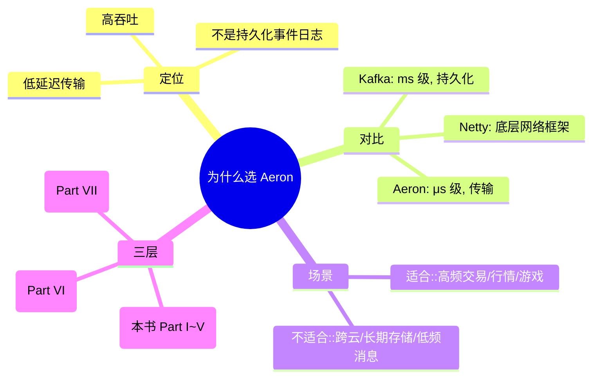
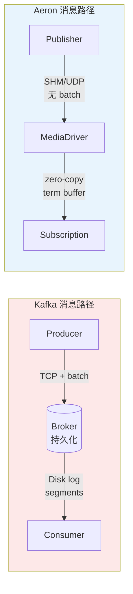
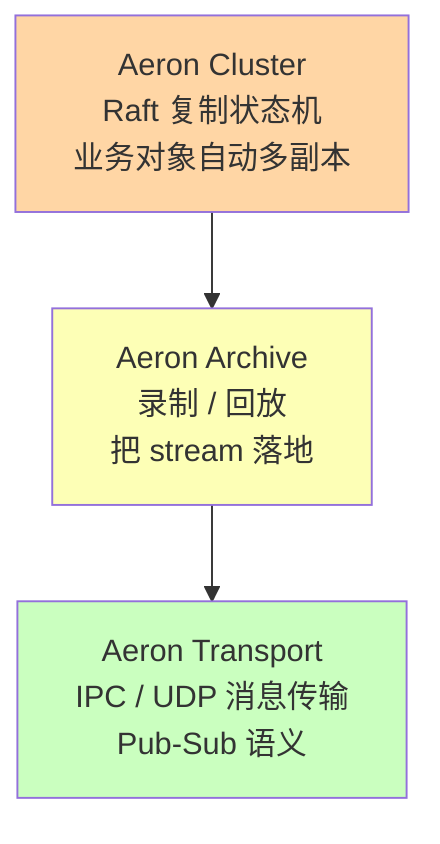

# 第 01 章 · 为什么选择 Aeron？消息模型对比

## 学习目标

- 用一句话说清楚 Aeron 定位；
- 分清"消息队列"、"事件日志"、"低延迟传输"三个概念；
- 会画 Aeron 与 Kafka / Netty / RabbitMQ / ZeroMQ 的对比矩阵；
- 明白什么场景 **不** 应该用 Aeron。

## 本章速览



**一图记住定位**：把 Aeron 想成"机房内部的高速公路"——快、直、专用，但不适合"跨省长途货运"（那种交给 Kafka）。

## 1.1 一句话定义

> **Aeron 是面向低延迟、高吞吐场景的消息传输系统。**

它支持三种传输介质：

| 介质 | Channel URI 前缀 | 延迟量级 | 备注 |
|---|---|---|---|
| 共享内存（IPC） | `aeron:ipc` | 亚微秒 | 同机器进程/线程间 |
| UDP 单播 | `aeron:udp?endpoint=host:port` | 微秒级 | 跨机器点对点 |
| UDP 多播 | `aeron:udp?endpoint=224.x.x.x:port` | 微秒级 | 跨机器 1→N |

## 1.2 Aeron 与 Kafka：不是"更快的 Kafka"

初学者最常犯的错就是把 Aeron 当 Kafka 用。这两者的设计目标完全不同：



**核心区别**：Kafka 把消息"存下来"，Aeron 把消息"送过去"。

```
Kafka                                 Aeron Transport
━━━━━━━━━━━━━━━━━━━━━━━━━━━━━━━      ━━━━━━━━━━━━━━━━━━━━━━━━━━━━━
Producer                              Publisher
   ↓ TCP (含 batch/compress)             ↓ SHM / UDP (无 batch)
Broker (持久化 event log)              Media Driver (只做传输)
   ↓ Disk (segments)                     ↓ 共享内存 term buffer
Consumer (consumer group)              Subscription (独立 poll)

存储：默认持久 (7 天+)              存储：无 (Archive 单独组件)
偏移：Broker 记 offset             偏移：Client 自己维护 position
吞吐：几十万 msg/s                 吞吐：单流 6M+ msg/s
延迟：ms 量级                      延迟：< 20 μs (IPC 亚微秒)
可靠：at-least-once/exactly-once   可靠：session-based，尽力可靠
```

### 对照矩阵

| 维度 | Kafka | Aeron Transport | Aeron Archive |
|---|---|---|---|
| 定位 | 事件日志 / 消息中间件 | 低延迟传输 | 传输 + 持久化/回放 |
| 部署 | Broker 集群 | MediaDriver 进程 | Archive 进程 |
| 存储 | 强制、可长期 | 无 | 可选、可 Replay |
| 消费者关系 | Consumer Group 竞争 | Subscription 广播 |
| 分区 | Partition 一等公民 | 无（用 stream/session 手工分） |
| 序列化 | 由业务定 | 由业务定（推荐 SBE） |
| 典型延迟 | ms | μs |
| 典型客户 | 数据管道、事件驱动系统 | 高频交易、行情、游戏、L1 撮合 |

## 1.3 Aeron 与 Netty

Netty 是"应用层网络框架"，帮你处理 TCP/UDP 的粘包、编解码、Handler 链等。
Aeron 是"消息传输系统"，比 Netty 更上层：

- Netty 给你 pipe，你自己造"消息协议"
- Aeron 给你 pub/sub + 可靠 UDP + 流控 + 广播 + 回放，"协议就是 Aeron 协议"

一个常见组合：

```
Binance WebSocket  ──> Netty (WS 解析) ──> Aeron (内部低延迟总线)
                              │
                              └─ Netty 负责跨互联网的复杂 IO
                                 Aeron 负责机房内的高性能消息分发
```

## 1.4 什么时候 **不** 该用 Aeron

- 需要跨云、跨 NAT、复杂路由：用 gRPC / MQ
- 需要长期持久化 + 复杂查询：用 Kafka + Kafka Streams / Flink
- 消息量小（<10k/s）、延迟不敏感：多引入一个 MediaDriver 太重
- 团队完全没有 DirectBuffer / 内存管理经验，且没时间学：先补 JVM 内存模型
- 你的核心问题是"函数调用慢"不是"消息慢"：先做 profile

## 1.5 Aeron 的三层：Transport / Archive / Cluster

官方仓库明确把开源栈分成 3 层：



**类比**：
- Transport = 高速公路
- Archive = 高速公路上的收费站 + 摄像头录像
- Cluster = 多条平行高速公路 + 自动切换车道

**学习顺序必须严格自底向上**：先玩透 Transport，再看 Archive，最后再碰 Cluster。
本书 Part I ~ V 全部是 Transport；Part VI 才进入 Archive；Part VII 才是 Cluster。

### 延迟量级直观对比

```
Kafka producer→consumer     ████████████████████████████ 5 ms
RabbitMQ                    █████████████████ 2 ms
gRPC LAN                    ██████ 500 μs
Aeron UDP LAN (10GbE)       █ 10 μs
Aeron IPC 8 字节            ▏ 500 ns
                            └─────────────────────────────
                            越短越快
```

从毫秒到纳秒的一整个数量级差距，就是选 Aeron 的第一理由。

## 1.6 版本选择

本书用 **Aeron 1.44.1**：
- 支持 Java 17 / 21
- API 和最新的 1.46.x 基本一致（Publication/Subscription 无破坏性改动）
- 目前生态里绝大部分教程和 cookbook 都以 1.4x 为基准

其他常见版本：
- `1.40.0` ：一些老 cookbook 代码基于这个版本
- `1.46.7` / `1.47.x` ：最新稳定，Cluster 部分 API 有微调，读官方 Wiki 即可

## 1.7 下一步

如果你还没读过 `../01.aeron 零基础入门.MD`，先回去把它看完，那份文档解释了"为什么先学 IPC"、"为什么是 offer/poll 而不是 callback"这些直觉问题；然后进入本书第 02 章，我们从"六个核心概念"开始正式构建心智模型。
