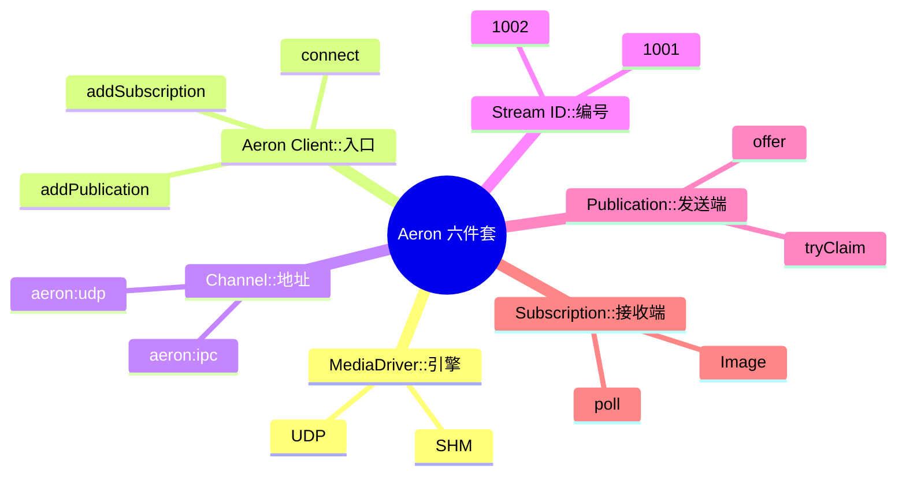
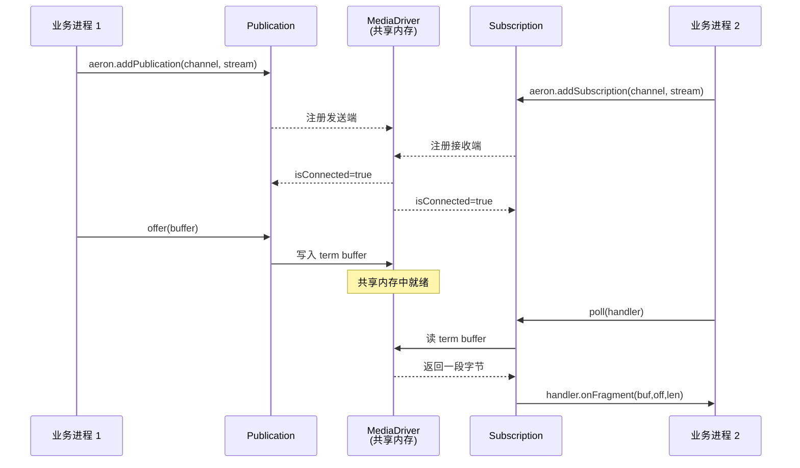

# 第 02 章 · 六个核心概念快览

## 学习目标

- 记住 Aeron 的六个核心组件；
- 用一张图串起来 MediaDriver / Aeron / Channel / Stream ID / Publication / Subscription 的关系；
- 分辨"看起来像 Kafka 但语义完全不同"的坑。

## 本章速览



**类比记忆**：Channel = 高速公路号（G4、G60），Stream ID = 车道号，Publication = 上匝道，Subscription = 下匝道，MediaDriver = 高速公路管理局，Aeron Client = 你的车。

## 2.1 六个概念

```
Aeron
│
├── MediaDriver     数据运输引擎（进程 or 内嵌线程）
│
├── Aeron           Java Client（业务进程与 driver 通信的入口）
│
├── Channel         运输通道（URI，如 aeron:ipc / aeron:udp?...）
│
├── Stream ID       同一 channel 里的逻辑数据流（int）
│
├── Publication     发送端（≈ Producer，但 offer() 有返回值语义）
│
└── Subscription    接收端（≈ Consumer，但主动 poll，不是 callback）
```

### 一句话记忆

| 组件 | 一句话说明 |
|---|---|
| MediaDriver | Aeron 真正干活的引擎，跑在共享内存文件之上 |
| Aeron (client) | 应用层与 driver 的 handshake 客户端，`Aeron.connect()` 得到 |
| Channel | Aeron URI 字符串，定义"用什么介质发到哪" |
| Stream ID | 32-bit 整数，把一个 channel 切成多路逻辑流 |
| Publication | `aeron.addPublication(channel, streamId)` |
| Subscription | `aeron.addSubscription(channel, streamId)` |

## 2.2 一次消息的完整时序



## 2.3 关系图

```
                          Machine A
   ┌─────────────────────────────────────────────────────┐
   │                                                     │
   │   Business Process 1        Business Process 2      │
   │   ┌──────────────┐          ┌──────────────┐        │
   │   │ Aeron Client │          │ Aeron Client │        │
   │   └──────┬───────┘          └──────▲───────┘        │
   │          │ Publication              │ Subscription  │
   │          ▼                          │               │
   │   ┌─────────────────────────────────┴──────────┐    │
   │   │                MediaDriver                 │    │
   │   │   (读写共享内存 term buffer)                │    │
   │   └────────────────────────────────────────────┘    │
   │                                                     │
   └─────────────────────────────────────────────────────┘
```

同机器：所有客户端通过共享内存与 MediaDriver 通信，走 `aeron:ipc` 走的就是这条路径。
跨机器：MediaDriver 内部的 sender/receiver 线程会把 term buffer 中的数据发到 UDP socket。

## 2.4 Channel + Stream ID = "在收发什么"

举例：

```java
String channel = "aeron:ipc";
int marketDataStream = 1001;
int orderStream      = 1002;
int fillStream       = 1003;
```

约定：

| Channel | Stream ID | 语义 |
|---|---|---|
| `aeron:ipc` | 1001 | Binance 归一化行情 |
| `aeron:ipc` | 1002 | 订单事件 |
| `aeron:ipc` | 1003 | 成交回报 |

Publisher 与 Subscriber 必须 **完全一致** 才能收到（channel 字符串一个字节都不能差）。

## 2.5 与 Kafka 的容易搞混的点

| 直觉类比 | 真相 |
|---|---|
| Stream ID ≈ Topic | ❌ Stream 只是 int，没有元数据；也没有分区 |
| Publication ≈ Producer | ✔ 但 `offer()` 不是 `send()`，见 Ch08 |
| Subscription ≈ Consumer | ✔ 但**多个 Subscription 都会收到全量**，见 Ch06 |
| Stream ID = broker 主题 | ❌ 无 broker 概念，MediaDriver 只是传输引擎 |
| 消费者用 group.id 分组 | ❌ Aeron 无 group 概念，负载均衡靠业务分片 |

## 2.6 Aeron 与 "会话 (Session)"

一个 Publication 每次 `addPublication` 都会分配一个新的 **sessionId**（32-bit）。
Subscriber 侧看到 `header.sessionId()` 就能区分"这条消息来自哪个 Publisher 实例"。

```
Publisher_A -> session=0x11abcd -> Subscription
Publisher_B -> session=0x22ef00 -> 同一个 Subscription
                              ^
Subscription 通过 sessionId 区分两条 image
```

`Image` 是"某个 Publisher 会话在 Subscription 侧的镜像"，一个 Subscription 可能有多个 Image（多个 Publisher 同时打过来）。Ch13 会详细讲。

## 2.7 心智模型：Aeron 是"共享 log + 独立读游标"

```
Publisher.offer(msg)
        │
        ▼
┌──────────────────────────────────┐
│   Term Buffer (环形 log)         │
│   ... msg_98 msg_99 msg_100 ...  │
└──────────────────────────────────┘
        ▲                ▲                ▲
        │                │                │
   Sub A pos=97     Sub B pos=99     Sub C pos=100
```

- 每个 Subscription 都是"独立读游标"
- Publisher 只是往 log 里追加
- MediaDriver 会根据 **最慢的**订阅者的位置来决定"log 什么时候可以覆盖"（IPC 场景）

这就是 Aeron 广播语义 + 流控的物理基础。Ch13 讲 Term Buffer 内部，Ch14 讲流控。

## 2.8 小结

- 六个组件 + 一张图 = Aeron 的骨架
- 不要生搬 Kafka 的心智模型
- 下一章我们把 pom.xml、log4j2、demo01 全部跑起来
