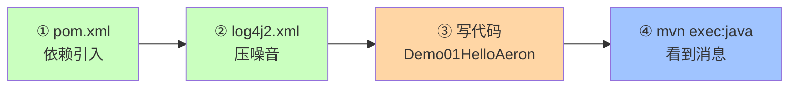
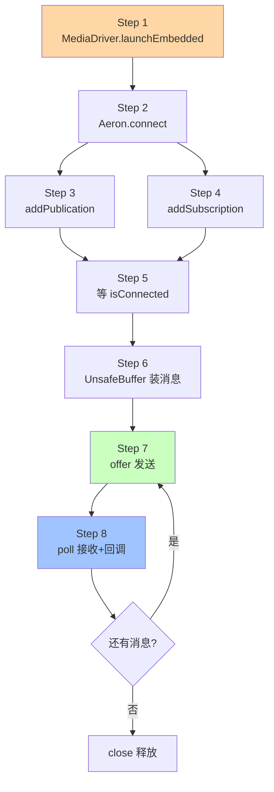
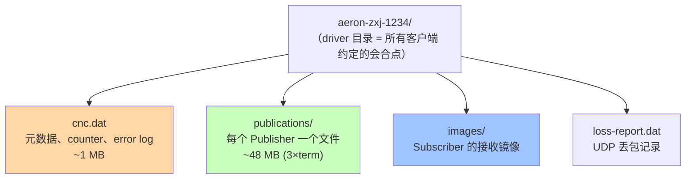

# 第 03 章 · 环境准备与第一个可运行程序

## 学习目标

- 搭好一个能编译、能跑的 Aeron Maven 工程；
- 亲手把 demo01 (`Demo01HelloAeron`) 跑起来，看到消息从 Publisher 流到 Subscriber；
- 知道日志里每个字段的含义。

## 本章速览



**四步走**：加依赖 → 配日志 → 写 main → 跑起来。总耗时 5 分钟。

## 3.1 依赖清单

`pom.xml`：

```xml
<properties>
    <maven.compiler.source>21</maven.compiler.source>
    <maven.compiler.target>21</maven.compiler.target>
    <aeron.version>1.44.1</aeron.version>
    <log4j.version>2.23.1</log4j.version>
</properties>

<dependencies>
    <dependency>
        <groupId>io.aeron</groupId>
        <artifactId>aeron-driver</artifactId>
        <version>${aeron.version}</version>
    </dependency>
    <dependency>
        <groupId>io.aeron</groupId>
        <artifactId>aeron-client</artifactId>
        <version>${aeron.version}</version>
    </dependency>
    <dependency>
        <groupId>org.apache.logging.log4j</groupId>
        <artifactId>log4j-core</artifactId>
        <version>${log4j.version}</version>
    </dependency>
</dependencies>
```

要点：
- `aeron-driver` 与 `aeron-client` 都要，前者含 `MediaDriver`；
- `aeron-client` 自动传染依赖 `agrona`（提供 `UnsafeBuffer` / `IdleStrategy`）；
- JDK 21 是本书基线；JDK 17 也能工作。

## 3.2 关闭 Aeron 内部日志的噪音

Aeron 内部用 `java.util.logging`，跑起来会打很多东西。用 log4j2 把它们压到 WARN：

`src/main/resources/log4j2.xml`：

```xml
<Configuration status="WARN">
    <Appenders>
        <Console name="Console" target="SYSTEM_OUT">
            <PatternLayout pattern="%d{HH:mm:ss.SSS} [%t] %-5level %logger{1} - %msg%n"/>
        </Console>
    </Appenders>
    <Loggers>
        <Logger name="io.aeron"   level="WARN"/>
        <Logger name="org.agrona" level="WARN"/>
        <Logger name="org.example" level="INFO"/>
        <Root level="INFO"><AppenderRef ref="Console"/></Root>
    </Loggers>
</Configuration>
```

## 3.3 最小可运行示例

**8 步走通全流程**：




参见配套代码 `aeron/src/main/java/org/example/demo01/Demo01HelloAeron.java`。核心 4 步：

```java
// 1. 内嵌 MediaDriver
try (MediaDriver driver = MediaDriver.launchEmbedded();
     // 2. 连接 Aeron Client（必须指向 driver 的目录）
     Aeron aeron = Aeron.connect(new Aeron.Context()
             .aeronDirectoryName(driver.aeronDirectoryName()));
     // 3. Publication & Subscription
     Publication publication  = aeron.addPublication("aeron:ipc", 1001);
     Subscription subscription = aeron.addSubscription("aeron:ipc", 1001)) {

    while (!publication.isConnected() || !subscription.isConnected()) {
        Thread.sleep(10);
    }

    UnsafeBuffer buffer = new UnsafeBuffer(ByteBuffer.allocateDirect(256));
    byte[] bytes = "hello-aeron".getBytes(StandardCharsets.UTF_8);
    buffer.putBytes(0, bytes);

    // 4. offer 发送
    while (publication.offer(buffer, 0, bytes.length) < 0) Thread.yield();

    // 5. poll 接收
    subscription.poll((buf, offset, length, header) -> {
        byte[] out = new byte[length];
        buf.getBytes(offset, out);
        log.info("收到: {}", new String(out, StandardCharsets.UTF_8));
    }, 10);
}
```

## 3.4 运行方式

命令行：

```bash
# 确保 JAVA_HOME 指向 JDK 21
export JAVA_HOME=/Library/Java/JavaVirtualMachines/jdk-21.jdk/Contents/Home
mvn -q exec:java -Dexec.mainClass=org.example.demo01.Demo01HelloAeron
```

预期输出：

```
13:19:02.055 [main] INFO  Demo01HelloAeron - 等待 Publication 与 Subscription 建立连接 ...
13:19:02.069 [main] INFO  Demo01HelloAeron - Publication / Subscription 已连接：aeron:ipc streamId=1001
13:19:02.070 [main] INFO  Demo01HelloAeron - [Publisher] 已发送：hello-aeron-0 (position=64)
13:19:02.070 [main] INFO  Demo01HelloAeron - [Subscriber] 收到消息：hello-aeron-0
...
```

## 3.5 日志字段解读

- `position=64`：这是发送成功后的 **流位置**（stream position），单位字节。
   每条消息占用的字节包含 **Aeron header (32 字节) + payload**，所以第一条 payload=11 字节，position=64（下一条起点）。
- `sessionId`：Publisher 的会话号，每次新建 Publication 会变；Subscriber 用它区分不同 Publisher 实例。
- `pos`：流位置在 Publisher 端和 Subscriber 端都能读，用于监控进度 / 排查延迟。

## 3.6 目录布局

内嵌 MediaDriver 会在 `java.io.tmpdir` 下生成一个类似 `/var/folders/xx/aeron-<user>-<timestamp>` 的目录：

```
aeron-zxj-1234/
├── cnc.dat                共享的 command-and-control 元信息
├── publications/          发布端 term buffer 文件
├── images/                Subscription 侧的重组镜像
└── loss-report.dat        丢失报告（Ch14 用）
```

**结构可视化**：



- 独立部署 MediaDriver 时（demo03）会使用固定目录 `${TMPDIR}/aeron-${user}`
- 如果上次异常退出留下了脏目录，用 `dirDeleteOnStart(true)` 清理，见 Ch04

## 3.7 常见启动错误

| 现象 | 原因 | 解决 |
|---|---|---|
| 一直卡在 `!publication.isConnected()` | `aeronDirectoryName` 没对齐，client 连的不是同一个 driver | 显式传目录 |
| `AeronException: Aeron driver not found` | driver 还没起 or 目录不存在 | 先启 driver 再 connect |
| `IllegalStateException: existing publication` | 同 channel+streamId 已存在 exclusive publication | 换 streamId 或关掉旧的 |
| 频繁 GC | 每次发送都 `new byte[]` / `new String` | 复用 UnsafeBuffer（Ch10） |

## 3.8 小结

跑通 demo01，你就完成了 Aeron 学习路径 Level 1~3。下一章开始，我们把 MediaDriver 单独拆出来讲：ThreadingMode、Context 配置、独立部署等真实生产考量。
