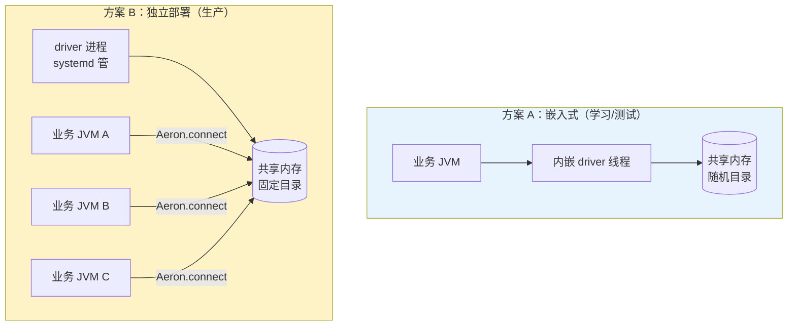
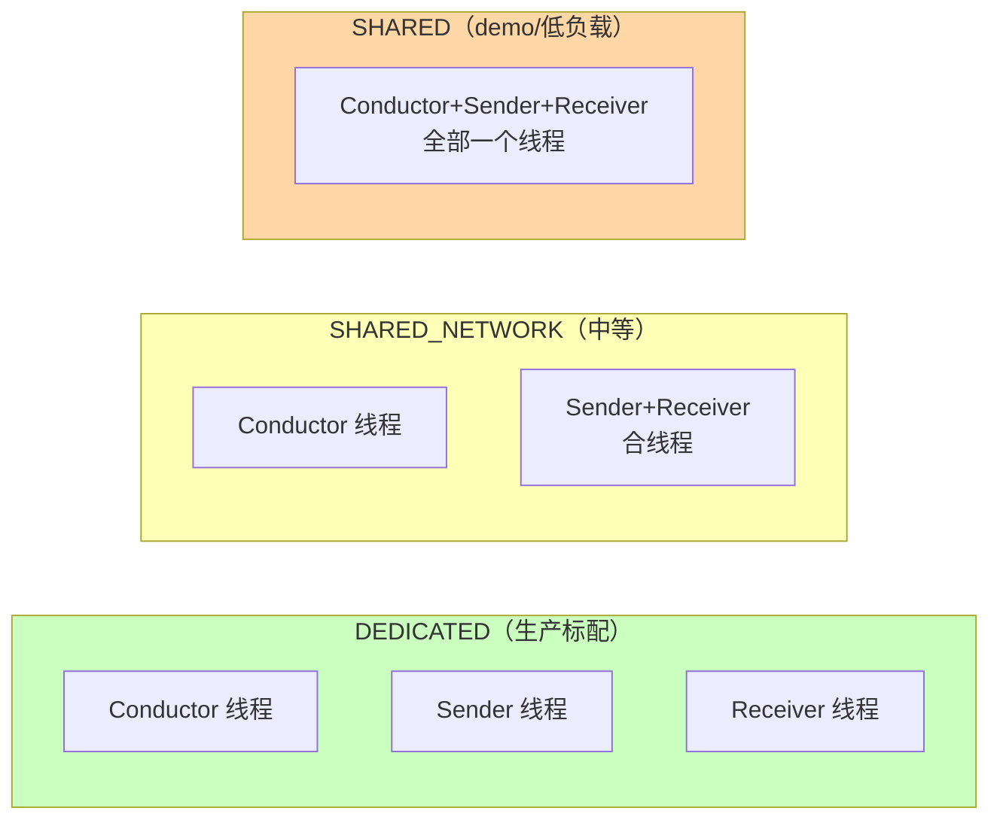
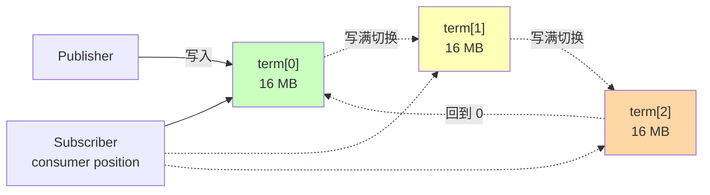

# 第 04 章 · MediaDriver：从嵌入式到独立部署

## 学习目标

- 弄清楚 `launch()` vs `launchEmbedded()` 的差别；
- 掌握 `ThreadingMode` 三种取值以及适用场景；
- 学会调整 term buffer 大小、目录路径、超时时间；
- 能独立部署 MediaDriver 给多个业务进程共用。

## 本章速览



## 4.1 MediaDriver 是什么

Aeron 真正干活的进程 / 线程。它的核心职责：

1. 分配并管理共享内存文件（term buffer、cnc.dat、loss report）；
2. 处理 UDP sender/receiver：把 term buffer 里的数据发到网卡，反之收下来放到 image；
3. Conductor 线程：负责与所有 Aeron Client 做 handshake、命令控制。

一个 MediaDriver 内部通常有三种角色线程：

```
┌────────────────────────────────────────┐
│               MediaDriver              │
│                                        │
│   ┌──────────┐   ┌──────────┐          │
│   │Conductor │   │  Sender  │          │
│   │(命令+心跳)│   │(UDP send)│          │
│   └──────────┘   └──────────┘          │
│                  ┌──────────┐          │
│                  │ Receiver │          │
│                  │(UDP recv)│          │
│                  └──────────┘          │
└────────────────────────────────────────┘
```

不同的 `ThreadingMode` 决定这三种角色是"各占一个线程"还是"合成一个线程"。

## 4.2 launch() vs launchEmbedded()

| 方法 | 目录 | 用途 |
|---|---|---|
| `MediaDriver.launch(ctx)` | 使用 ctx 里的 `aeronDirectoryName`（默认 `${TMPDIR}/aeron-${user}`）| 独立进程部署；同机器只能有一个默认目录的实例 |
| `MediaDriver.launchEmbedded(ctx)` | 自动生成随机目录 `aeron-<user>-<epoch>-<random>` | 内嵌 driver；同机器可并存多个 |

```java
// 独立部署：明确目录，所有客户端都连到这里
MediaDriver driver = MediaDriver.launch(new MediaDriver.Context()
    .aeronDirectoryName("/dev/shm/aeron/prod-driver"));

// 嵌入式：适合 demo、集成测试、单进程 all-in-one
MediaDriver driver = MediaDriver.launchEmbedded();
```

## 4.3 ThreadingMode 三种

| 模式 | 线程数 | 适用 |
|---|---|---|
| `DEDICATED` | 3（Conductor + Sender + Receiver 各一） | 高性能生产、每个线程绑核 |
| `SHARED_NETWORK` | 2（Conductor 一个，Sender+Receiver 合一）| 中等负载 |
| `SHARED` | 1（三合一） | 学习 / 低负载 / CPU 紧张 |
| `INVOKER` | 0（不启 driver 线程，业务代码手动调 `invoke()`） | 单线程模型，用于内嵌到 Netty EventLoop 等 |

**线程模型可视化**：



配置示例：

```java
MediaDriver.Context ctx = new MediaDriver.Context()
    .threadingMode(ThreadingMode.DEDICATED)
    .conductorIdleStrategy(new BackoffIdleStrategy(...))
    .senderIdleStrategy(new NoOpIdleStrategy())    // 极致低延迟：sender 忙等
    .receiverIdleStrategy(new NoOpIdleStrategy());
```

绑核可以在启动时用 `taskset`（Linux）或 JVM 层面 `Thread.setName()` + 外部工具完成。

## 4.4 关键 Context 参数

### 4.4.1 `aeronDirectoryName`

- 默认：`${TMPDIR}/aeron-${user}`
- 建议：生产设为 tmpfs（`/dev/shm/aeron-xxx`），避免磁盘 IO 干扰
- 必须让 driver 与所有客户端一致

### 4.4.2 `dirDeleteOnStart` / `dirDeleteOnShutdown`

```java
ctx.dirDeleteOnStart(true).dirDeleteOnShutdown(true);
```

开发时打开可以避免"上次没关干净"导致 `ActiveDriverException`。
生产建议 **关闭 dirDeleteOnShutdown**，方便崩溃后取证。

### 4.4.3 `termBufferSparseFile`

- true（默认）：稀疏文件，只在需要时物理占用磁盘；对开发友好
- false：预分配，第一次写入无缺页 fault；生产建议 false，前提是 tmpfs 空间够

### 4.4.4 Term Buffer 大小

Aeron 的每个 Publication 都有 3 个 term buffer（三段循环）：



**记忆**：三个 term 循环，就像三个跑道轮流用；某个跑道消费者还没走完，Publisher 就得停下（BackPressure）。

```java
ctx.publicationTermBufferLength(1 << 24);         // 16 MB × 3 = 48 MB
ctx.ipcPublicationTermBufferLength(1 << 22);      // IPC 用小一点：4 MB × 3
```

- 太小：BackPressure 触发太快（Ch08）
- 太大：内存浪费、初始化慢
- 必须是 2 的幂，最大 1 GB

### 4.4.5 超时

```java
ctx.clientLivenessTimeoutNs(TimeUnit.SECONDS.toNanos(10));     // client 被认为死掉的时间
ctx.imageLivenessTimeoutNs(TimeUnit.SECONDS.toNanos(10));      // Image 存活时间
ctx.publicationUnblockTimeoutNs(TimeUnit.SECONDS.toNanos(15)); // Publisher 卡住多久算死
```

高频交易场景通常调短，方便快速切换到备份路径。

## 4.5 独立部署示例

我们的配套代码 demo03 就是独立部署的三个进程：

```
Demo03aStandaloneMediaDriver  ─┐
                               │  共享 /var/folders/.../aeron-zxj
Demo03bSubscriberProcess  ─────┤
                               │
Demo03cPublisherProcess  ──────┘
```

生产上，还会再加一层：把 driver 打成 fat jar 或 native image，systemd 管理：

```ini
# /etc/systemd/system/aeron-driver.service
[Service]
Type=simple
User=aeron
ExecStart=/usr/bin/java -XX:+AlwaysPreTouch -Xms1g -Xmx1g \
    -jar /opt/aeron/aeron-driver.jar \
    --aeron.dir=/dev/shm/aeron-prod
Restart=always
LimitNOFILE=100000
LimitMEMLOCK=infinity
```

## 4.6 Context 的常用调优矩阵

| 场景 | ThreadingMode | 目录 | Term Size | 说明 |
|---|---|---|---|---|
| 本地 demo | SHARED | tmp | 默认 | 简单 |
| 集成测试 | SHARED_NETWORK | tmpfs | 4 MB | 快启动 |
| 内部 IPC 生产 | SHARED_NETWORK | tmpfs | 16 MB | IPC 不需要 sender/receiver 拆分 |
| 跨机 UDP 生产 | DEDICATED | tmpfs | 32 MB | 三线程绑核 |
| 高频行情 | DEDICATED + NoOp idle + 绑核 | tmpfs + 大 term | 64 MB | 争取每一微秒 |

## 4.7 常见坑

1. **两次 `launch()` 起在同一台机器**：报 `ActiveDriverException`。用 `launchEmbedded()` 或换目录。
2. **忘记设 `aeronDirectoryName`**：内嵌 driver 每次目录随机，客户端连接的目录不对。
3. **停机残留目录**：`ls /dev/shm | grep aeron` 手工清理，或用 `dirDeleteOnStart(true)`。
4. **term buffer 太小导致高频 BackPressure**：加大或换 `ExclusivePublication`。
5. **`INVOKER` 模式忘调 `driverAgentInvoker.invoke()`**：一切静止，什么消息都没有。

## 4.8 下一步

MediaDriver 就位后，客户端就要用 `Publication` / `Subscription` 收发。第 05 章我们把 Publication 拆开讲：exclusive vs concurrent、position、可靠性、生命周期。
