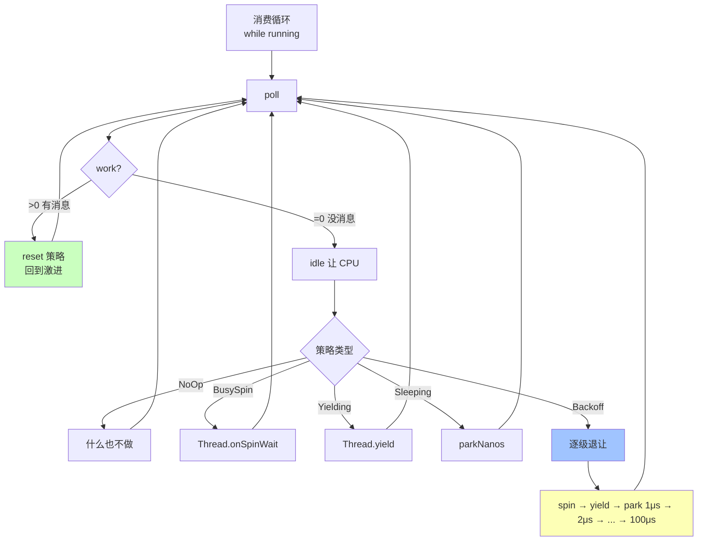

# 第 09 章 · IdleStrategy 与低延迟循环设计

## 学习目标

- 记住 Agrona 提供的 5 种 IdleStrategy 的策略取舍；
- 会为不同场景选择合适的策略；
- 掌握 `idle(work)` 模式，避免"忙等 100% CPU"和"睡太久漏消息"两个极端；
- 了解 driver 内部 IdleStrategy 的配置方式。

## 本章速览：延迟 vs CPU 的取舍谱

```
   延迟低               CPU 高
   ─────────────────────────▶
   NoOp / BusySpin      Yielding    Backoff       Sleeping
     │                    │           │              │
   100% CPU            100% CPU    自适应         低 CPU
   亚微秒              μs 级       混合           ms 级延迟
   适合绑核            适合竞争    ★生产默认      适合后台

   ◀─────────────────────────
   CPU 高                延迟高
```



## 9.1 Aeron 消费循环的骨架

```java
while (running) {
    int work = subscription.poll(handler, LIMIT);
    idleStrategy.idle(work);
}
```

`idle(work)` 的语义：**"你告诉我这次干了多少活，我决定要不要让 CPU 歇一下"**。

- `work > 0`：策略 reset 到最激进状态
- `work == 0`：递进式退让（先自旋，再 yield，再 park）

## 9.2 五种 IdleStrategy

| 类 | 行为 | CPU | 延迟 | 场景 |
|---|---|---|---|---|
| `NoOpIdleStrategy` | 完全不让 CPU（不调 onSpinWait） | 100% | 极低 | 绑核忙循环 |
| `BusySpinIdleStrategy` | `Thread.onSpinWait()` | 100% | 极低 | 绑核忙循环，但对 SMT 友好 |
| `YieldingIdleStrategy` | `Thread.yield()` | 100% | 低 | 有其他线程竞争但不能等 |
| `SleepingIdleStrategy(ns)` | `LockSupport.parkNanos(ns)` | 低 | 与 ns 成正比 | 后台任务、日志 |
| `SleepingMillisIdleStrategy(ms)` | `Thread.sleep(ms)` | 极低 | 与 ms 成正比 | 慢管道 |
| `BackoffIdleStrategy(spin, yield, minPark, maxPark)` | 分阶段：先 spin → yield → park 逐渐涨到 maxPark | 自适应 | 中等 | **生产默认** |

## 9.3 BackoffIdleStrategy 详解

```java
IdleStrategy idle = new BackoffIdleStrategy(
    100,                                    // maxSpins  : 连续空转多少次后进入 yield
    10,                                     // maxYields : 连续 yield 多少次后进入 park
    TimeUnit.MICROSECONDS.toNanos(1),       // minParkNs
    TimeUnit.MICROSECONDS.toNanos(100));    // maxParkNs
```

执行路径：

```
work>0 → reset
work==0 first  100 次  → onSpinWait
      then    10  次  → Thread.yield()
      then    park 1μs
      then    park 2μs
      then    park 4μs
      ...
      直到 park maxParkNs=100μs
```

一旦 `work > 0`，立刻回到"最激进"。

## 9.4 场景选择矩阵

| 场景 | 选择 |
|---|---|
| 撮合引擎主循环，绑核 | `NoOpIdleStrategy` |
| 行情 gateway，绑核 | `BusySpinIdleStrategy` |
| 一般低延迟微服务 | `BackoffIdleStrategy(100, 10, 1μs, 100μs)` |
| 后台监控 / recorder | `BackoffIdleStrategy(10, 5, 100μs, 10ms)` |
| 完全非关键 | `SleepingIdleStrategy(1ms)` |

## 9.5 driver 内部 IdleStrategy

MediaDriver 里有 3 类线程，各自可以配自己的 IdleStrategy：

```java
MediaDriver.Context ctx = new MediaDriver.Context()
    .threadingMode(ThreadingMode.DEDICATED)
    .conductorIdleStrategy(new BackoffIdleStrategy(...))
    .senderIdleStrategy(new NoOpIdleStrategy())
    .receiverIdleStrategy(new NoOpIdleStrategy());
```

高频行情场景常见配置：
- Sender / Receiver：`NoOpIdleStrategy` + 绑核
- Conductor：`BackoffIdleStrategy`（不关键，让出 CPU）

## 9.6 Composite Agent + AgentRunner

Aeron 的低延迟世界里，一个线程往往同时干"消费 + 发送 + 定时器"，模式是：

```java
class MyAgent implements Agent {
    public int doWork() {
        int work = 0;
        work += subscription.poll(handler, 20);
        work += pollTimers();
        work += flushOutputs();
        return work;
    }
    public String roleName() { return "market-worker"; }
}

AgentRunner runner = new AgentRunner(
    new BackoffIdleStrategy(100, 10, 1_000, 100_000),
    Throwable::printStackTrace,
    null,
    new MyAgent());

AgentRunner.startOnThread(runner);
```

好处：
- IdleStrategy 由 AgentRunner 自动管
- 优雅停止：`runner.close()`
- 与 Aeron/Archive 官方 sample 完全对齐（cookbook 中大量使用）

## 9.7 常见误区

1. **一开始就用 BusySpin**：把 CPU 打满，后台线程都跑不了 → 除非绑核否则用 Backoff。
2. **每次 poll 都 sleep(1)**：延迟 500μs+，几乎失去 Aeron 的优势。
3. **`idle(work)` 传常量**：想想第一次要不要 reset，逻辑就坏了。
4. **在 handler 里 sleep**：影响本 poll 的 fragmentLimit 处理速度，同时会阻塞其他 Image。

## 9.8 一段"复合 agent"示例

```java
class MarketWorker implements Agent {
    private final Subscription tickSub;
    private final Publication  aggPub;
    private final UnsafeBuffer scratch;

    public int doWork() {
        int w = 0;
        w += tickSub.poll(this::handleTick, 20);
        w += publishAggregatesIfDue();
        return w;
    }

    private void handleTick(DirectBuffer b, int o, int l, Header h) {
        // 汇总
    }
    private int publishAggregatesIfDue() {
        if (!due()) return 0;
        long r = aggPub.offer(scratch, 0, aggLen);
        return r > 0 ? 1 : 0;
    }
    public String roleName() { return "market-worker"; }
}
```

一个线程，Backoff idle，既消费又生产，是低延迟系统最经典的骨架。

## 9.9 小结

- IdleStrategy 是"如何让 CPU 歇"的一等公民；
- BackoffIdleStrategy 是生产默认；
- Aeron 提供的 AgentRunner + Agent 抽象让 idle 逻辑消失在框架里；
- Ch12 (SBE) / Ch25 (行情总线) 会大量复用这套 pattern。
