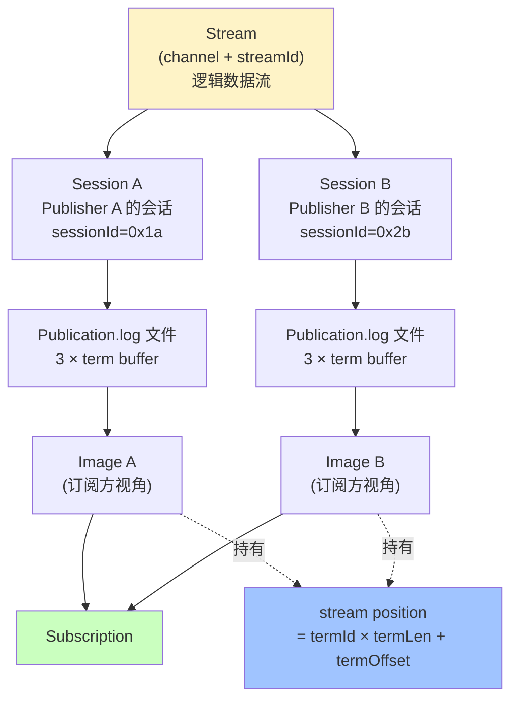

# 第 13 章 · Image / Session / Term Buffer

## 学习目标

- 把 Session、Image、Term Buffer、Position 四个词的关系全部串起来；
- 明白 term buffer 的三段循环结构；
- 学会用 Image API 精确控制"从哪里开始 poll"；
- 知道 stream position 的物理编码方式。

## 本章速览：四个词的层级关系



## 13.1 一张全景图

```
Publisher (sessionId=S) ─── offer/tryClaim ───▶
                                                │
                                                ▼
┌────────────────────────────────────────────────────────────┐
│              Publication.log (共享内存文件)                 │
│                                                            │
│  term[0]  │  term[1]  │  term[2]                           │
│ ─────────  ─────────  ─────────                            │
│  循环使用（rotating log），Publisher / Subscriber 各自 term │
└────────────────────────────────────────────────────────────┘
                                                ▲
                                                │
Subscription (客户端) ──── poll ────▶ Image(sessionId=S)
                                       持有对同一文件的只读映射
```

关键点：
- **每个 Publisher 会话** → 一个 Publication.log 文件（三段 term）
- **每个订阅方** → 通过 `Image` 拿到这个文件的只读 mmap
- 一个 Subscription 可以有 **多个 Image**（多个 Publisher 打给它）

## 13.2 Term Buffer 三段循环

```
term-length = T bytes（比如 16 MB）
一个 Publication.log 文件包含 3 × T 的空间

┌──────────┬──────────┬──────────┐
│ term[0]  │ term[1]  │ term[2]  │
└──────────┴──────────┴──────────┘
    0..T-1     T..2T-1   2T..3T-1
```

写入 term[0] 满了 → 切到 term[1] → 满了 → 切到 term[2] → 满了 → 回到 term[0]

**回到 term[0] 前，必须确保所有订阅者已经消费过 term[0]**，否则 Publisher 被 BackPressure 挂住。

## 13.3 Stream Position 的编码

**位打包示意**（64-bit long）：

```
 63           32 31           0
 ┌─────────────┬─────────────┐
 │   termId    │  termOffset  │
 │  (32 bit)   │   (32 bit)   │
 └─────────────┴─────────────┘
        ▲              ▲
     term 编号     term 内偏移
    (0,1,2 循环)   (0 ~ termLen-1)

position = (termId << 32) | termOffset   (概念上)
       = termId * termLen + termOffset (语义上)
```


一个 64-bit 的 position 里：

```
+──────────────────────+──────────────+
│ termId (32-bit)      │ termOffset  │
+──────────────────────+──────────────+
   位于哪个 term (自增)     term 内偏移
```

从 position 反解：

```java
int termLength = ...;
int positionBits = Integer.numberOfTrailingZeros(termLength);
int termId       = (int) (position >> positionBits);
int termOffset   = (int) (position & (termLength - 1));
```

Aeron 提供辅助：`LogBufferDescriptor.computePosition(termId, termOffset, positionBits, initialTermId)`。

## 13.4 Image 提供的 API

```java
Image image = subscription.imageAtIndex(0);  // 或 imageBySessionId(...)

long pos   = image.position();
int  termId = image.termId();
int  termOffset = image.termOffset();
int  sessionId = image.sessionId();
String sourceIdentity = image.sourceIdentity(); // "ip:port" (UDP) or "unknown" (IPC)

int poll(FragmentHandler h, int limit);
int controlledPoll(ControlledFragmentHandler h, int limit);
int boundedPoll(FragmentHandler h, long limitPos, int fragmentLimit);
int blockPoll(BlockHandler h, int blockLengthLimit);
```

**boundedPoll** 特别有用：只允许 poll 到某个 position 为止，做"回放到检查点"：

```java
long checkpointPos = image.position() + 1_000_000;   // 允许再读 1 MB
image.boundedPoll(handler, checkpointPos, 10);
```

## 13.5 Session ID 的分配

- **随机模式**（默认）：Aeron client 生成 32-bit 随机；
- **手动模式**：URI 里加 `session-id=12345`；
- **范围保留**：`Aeron.Context.publicationReservedSessionIdLow / High`。

在 Cluster 里，consensus module 会保留一段 sessionId 给自己内部通信。

## 13.6 Publication.log 文件布局

在 `${aeronDir}/publications/${sessionId}-${streamId}-...` 下：

```
+──────────── 64 KB header ────────────+
│ log metadata: term-length, mtu, ...   │
+──────────────────────────────────────+
│ term[0]                               │
+──────────────────────────────────────+
│ term[1]                               │
+──────────────────────────────────────+
│ term[2]                               │
+──────────────────────────────────────+
```

metadata 里存 `activeTermId` / `termOffset` / `publisherPosition` 等。

用 `LogBufferDescriptor` API 可以读这些字段做深度诊断。

## 13.7 Image 的可用性事件

Subscription 上可以注册两个 callback：

```java
aeron.addSubscription(
    channel, streamId,
    image -> log.info("上线 sessionId={} src={}", image.sessionId(), image.sourceIdentity()),
    image -> log.info("下线 sessionId={} pos={}", image.sessionId(), image.position()));
```

生产环境这些事件通常上报到监控（每个 sessionId 对应哪个上游）。

## 13.8 一段"按 sessionId 分发"的示例

有些系统希望"某个 sessionId 的消息进入队列 A，其他进入队列 B"：

```java
Long2ObjectHashMap<MyQueue> routing = new Long2ObjectHashMap<>();

subscription.forEachImage(image -> {
    MyQueue q = routing.get(image.sessionId());
    if (q != null) image.poll(q::enqueue, 20);
});
```

`forEachImage` 让你对每个 Image 单独 poll，非常灵活。

## 13.9 常见陷阱

1. **假设 Subscription 只有一个 Image**：真实系统里多 Publisher 是常态，用 `forEachImage` 或按 sessionId 处理。
2. **持有 Image 引用**：Image 可能被 driver 回收（订阅方断开），需要检查 `image.isClosed()`。
3. **手动指定 sessionId 冲突**：Cluster 场景要小心，别撞到 consensus 的保留段。
4. **term-length 太小**：Publisher 一秒轮 term 好几次，出现严重 BackPressure。

## 13.10 小结

- Aeron 传输的基础单位是 term buffer；
- Session/Image/Term 三个词描述同一条流的不同层面；
- Image 提供丰富 API 满足从 poll 到 replay 的所有场景。
