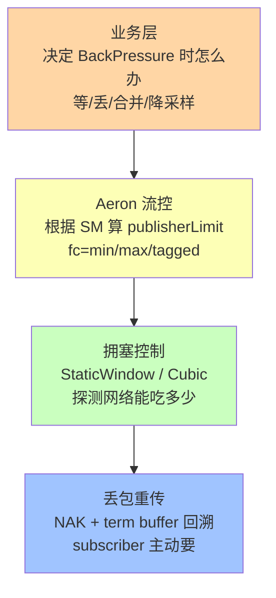
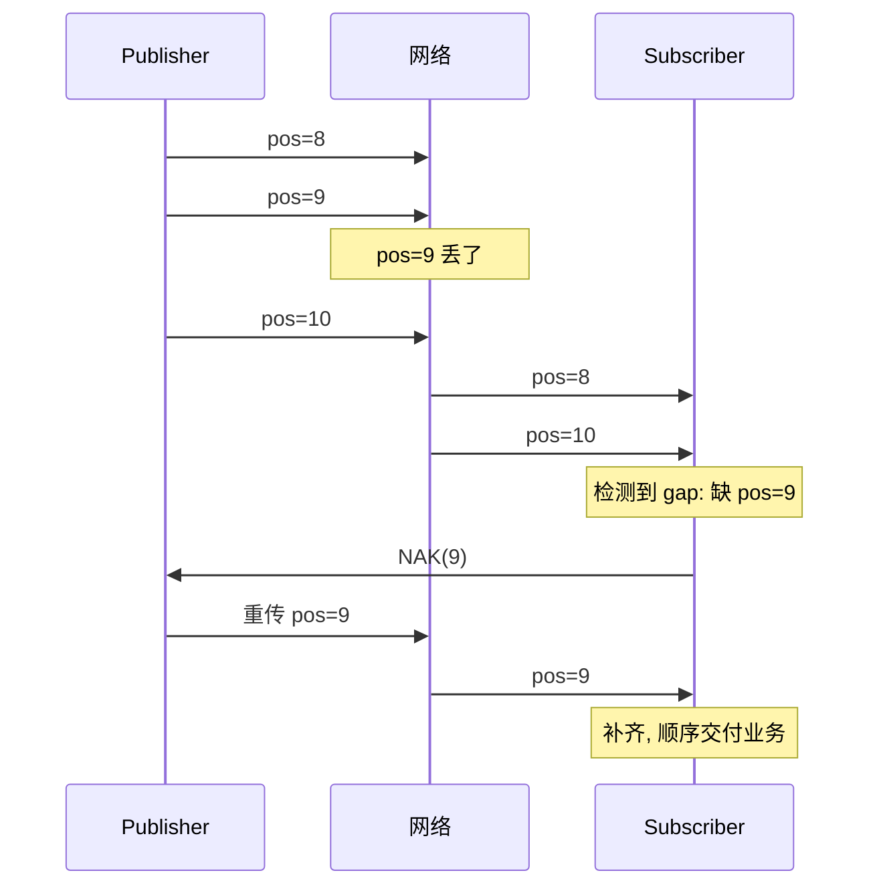

# 第 14 章 · 流控、拥塞控制与 Loss Recovery

## 学习目标

- 理解 Aeron 的流控模型（sender-based）；
- 认清"Flow Control"、"Congestion Control"、"Loss Recovery"三层的分工；
- 会为不同订阅拓扑选择合适的 flow control 策略；
- 知道丢包时的重传机制以及 NAK。

## 本章速览：三层控制职责



**记忆**：三层像高速公路的三种规则——你自己控制车速（业务）+ 交通信号（流控）+ 匝道拥堵调度（拥塞）+ 追尾后拖车重新走（丢包重传）。

## 14.1 三层控制

```
应用层        Business decision on BACK_PRESSURED       ← Ch08
─────────────────────────────────────────────────────
Aeron 流控    Publisher 侧根据订阅 position 决定发多少   ← 本章
             （Flow Control Strategy）
─────────────────────────────────────────────────────
UDP 拥塞控制  防止把网络打死（Congestion Control）        ← 本章
─────────────────────────────────────────────────────
UDP 丢包重传  NAK-based, term buffer 内可回溯           ← 本章
```

## 14.2 IPC 流控

IPC 场景没有网络拥塞，也不会真"丢"消息。流控完全基于 term buffer 空间：

```
publisherLimit = min(consumerPositions) + termWindowLength
```

- `termWindowLength` = term-length / 2（默认）
- Publisher 超过 limit 就 BACK_PRESSURED

调整方式：加大 term-length，或者优化 consumer。

## 14.3 UDP 流控策略

Subscriber 会定期发 **Status Message (SM)** 给 Publisher，报告自己的 consumer position。Publisher 根据所有已知 SM 计算 publisherLimit。

多个 Subscriber 的场景，Aeron 提供不同"合并策略"：

| 策略类 | 语义 | 场景 |
|---|---|---|
| `MinMulticastFlowControl` | 采用 **最慢** 订阅者的 position | 保证不丢：所有订阅者都要跟上 |
| `MaxMulticastFlowControl` | 采用 **最快** 订阅者的 position | 慢订阅者会掉队（丢消息） |
| `PreferredMulticastFlowControl` | 只关心 tag 匹配的订阅者 | 有主备订阅者时 |
| `DefaultUnicastFlowControl` | 单播默认 | 单个订阅方 |

配置：

```java
MediaDriver.Context ctx = new MediaDriver.Context()
    .multicastFlowControlSupplier(new MinMulticastFlowControlSupplier());
```

或者按 channel 指定：

```
aeron:udp?endpoint=224.0.0.1:40456|fc=min                    # min
aeron:udp?endpoint=224.0.0.1:40456|fc=max                    # max
aeron:udp?endpoint=224.0.0.1:40456|fc=tagged,g:0/1           # tagged
```

## 14.4 拥塞控制

Aeron 的拥塞控制发生在 sender：如果检测到丢包/慢确认，会主动降速（类似 TCP CUBIC）。可选：

- `StaticWindowCongestionControl`（默认，简单）：固定 window
- `CubicCongestionControl`：TCP CUBIC 曲线，适合共享网络

```java
ctx.congestionControlSupplier(new CubicCongestionControlSupplier());
```

## 14.5 Loss Recovery：NAK

Aeron 用 **NAK (Negative ACK)** 机制而不是 TCP 的 ACK：

- Subscriber 发 SM 告诉 Publisher"我已经 poll 到 pos X"；
- 如果 Subscriber 检测到 gap（比如收到 pos=10 但 pos=8~9 没收到），发 **NAK**；
- Publisher 侧 term buffer **还没被覆盖** → 重传丢失字节；
- 覆盖了 → subscriber 记 Loss，见 `loss-report.dat`。

因此：**term buffer 越大，能容忍的丢包时间窗口越长**。

**NAK 时序示例**：



**关键点**：只有 Publisher 的 term buffer 还没覆盖 pos=9 时，重传才成功；否则记入 loss-report。

## 14.6 Loss Report

driver 目录下 `loss-report.dat` 是所有丢包事件的记录：

```java
LossReportReader.read(mmapBuffer, (observationCount, totalBytesLost, firstObservationTs, lastObservationTs,
                                    sessionId, streamId, channel, source) -> {
    log.warn("丢失 {} 次, {} 字节, channel={}, session={}",
        observationCount, totalBytesLost, channel, sessionId);
});
```

线上必须监控。

## 14.7 Publisher UnBlock

如果 Publisher 卡住太久（BackPressure 超过 `publicationUnblockTimeoutNs`，默认 15 s），driver 会强制 unblock（丢弃当前写入位置的消息），避免死锁。

排查思路：
- Publisher 长时间 UnBlock → 消费者跟不上 or 掉线
- 加监控：`system_publication_unblock` counter

## 14.8 SM 频率

Subscriber 发 SM 的频率影响流控精度：

```java
ctx.statusMessageTimeoutNs(TimeUnit.MILLISECONDS.toNanos(200));   // 默认 200 ms
```

高频交易场景建议调短到 10~50 ms，让 Publisher 更快感知消费速度。

## 14.9 一个"下游主备"的场景

假设有两个订阅者，主用要 100% 保证不丢，备用可以慢：

方案 A：用两个 channel，主用走 `fc=min`（保证 preferred sub），备用走另一个 channel + 大 term
方案 B：`fc=tagged`，给主用打上 tag：

```
Publisher: aeron:udp?endpoint=...|fc=tagged,g:0/1
主 Sub   : aeron:udp?endpoint=...|gtag=1
备 Sub   : aeron:udp?endpoint=...
```

流控只看 gtag=1 的订阅者。

## 14.10 常见陷阱

1. **多播用 min 但备份订阅者很慢**：Publisher 被拖慢，加 tagged 或分流。
2. **term 太小**：丢包重传窗口太短，`loss-report` 满地。
3. **SM 间隔太长**：流控不及时，BackPressure 突发。
4. **忘看 loss-report**：默默丢数据。

## 14.11 小结

- Aeron 流控是"sender pull"模型：SM 是核心信号；
- Multicast 场景要选对 `fc=` 策略；
- NAK + term buffer 提供"应用无感知"的丢包重传；
- Loss Report 必须监控。
