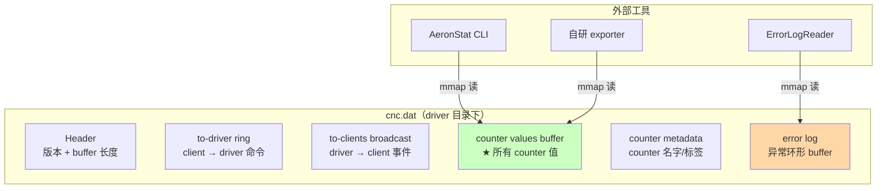

# 第 15 章 · Counters 与诊断

## 学习目标

- 理解 Aeron 的 Counters 系统（共享内存 counter file）；
- 学会用 `AeronStat` / `CncFileReader` 观察运行时状态；
- 认识常用系统 counter；
- 能自定义业务 counter 挂到 Aeron 上，一并被工具观察。

## 本章速览：cnc.dat 里到底存什么



## 15.1 Cnc & Counter 概览

driver 目录下 `cnc.dat` 是所有 driver ↔ client 通信的元数据文件。其中一段专门给"counter"用：

```
cnc.dat
├── header (version, buffer lengths)
├── to-driver ring buffer          (client → driver 命令)
├── to-clients broadcast buffer    (driver → client 事件)
├── counter values buffer          ← 观察工具关心
├── counter metadata buffer        ← 名字、标签
└── error log
```

每个 counter 是 128 字节对齐的槽，含 8 字节的 volatile long value + metadata。

## 15.2 AeronStat 工具

Aeron 官方 samples 里有个命令行工具 `AeronStat`，直接 `mmap` cnc.dat 打印所有 counter：

```bash
java -cp aeron-samples-1.44.1-all.jar io.aeron.samples.AeronStat \
     -Daeron.dir=/var/folders/xxx/aeron-zxj-xxx
```

典型输出：

```
1:                   0 - Bytes sent
2:               12345 - Bytes received
3:                   0 - Failed offers
4:                   0 - Errors
5:                42 - Loss gap fills
...
100:  pub-lmt 0:1001:4c9c5b4a - 4194304
101:  pub-pos 0:1001:4c9c5b4a - 3145728
102:  sub-pos 0:1001:4c9c5b4a:client-1 - 2097152
```

线上排障必备。

## 15.3 常用系统 counter

| 名字 | 含义 | 出问题的迹象 |
|---|---|---|
| `Bytes sent` / `Bytes received` | 总字节 | 数字停滞 = 流量断 |
| `Failed offers` | offer 返回负值的次数 | 增长快 = BackPressure |
| `Client keep-alives` | client → driver 心跳 | 停滞 = client 挂掉 |
| `Errors` | 错误计数 | >0 立刻查 error log |
| `Loss gap fills` | 通过 NAK 补回来的字节 | 增长快 = 网络丢包严重 |
| `Publisher back-pressured` | Publisher BackPressure 次数 | 需要业务侧优化 |
| `Publisher NAK count` | 收到 NAK 数 | 与 Loss 相关 |
| `Sender flow control limit` | 发送 window | 判断是否被流控卡住 |
| `Subscription connect events` | 订阅上下线 | 频繁抖动 = 网络问题 |
| `Publication limit` (`pub-lmt`) | Publisher 允许写到的位置 | 逼近 pub-pos 说明满 |
| `Publication position` (`pub-pos`) | Publisher 当前位置 | 增长速度 = 吞吐 |
| `Subscription position` (`sub-pos`) | 每个订阅方位置 | pub-pos - sub-pos = 积压 |

## 15.4 计算"积压"

```
backlog_bytes = pub-pos - min(sub-pos_i)
```

监控这个数即可看到"消费者是否跟得上"。IPC 场景 backlog 一旦逼近 term-length，就要注意即将 BackPressure。

**积压可视化**：

```
term-length = 16 MB, window = 8 MB

pub-pos ─────────────────────┐
                             ▼
[═══════════════════════════════════════]  term buffer
 ▲              ▲                     ▲
 │              │                     │
 sub-pos-slow   sub-pos-fast          pub-pos
 (2 MB)         (10 MB)               (11 MB)

backlog vs 慢消费者 = 9 MB   ← 已超过 window/2, 危险
backlog vs 快消费者 = 1 MB   ← 健康
```


## 15.5 CncFileReader（编程方式）

如果你想在自己的监控 agent 里读 counter，用 API：

```java
try (CncFileDescriptor cncFile = new CncFileDescriptor(...);
     CountersReader counters = new CountersReader(
         cncFile.createCountersMetaDataBuffer(),
         cncFile.createCountersValuesBuffer())) {

    counters.forEach((counterId, typeId, keyBuffer, label) -> {
        long value = counters.getCounterValue(counterId);
        log.info("[{}] {} = {}", counterId, label, value);
    });
}
```

## 15.6 自定义业务 counter

Aeron 允许你注册自己的 counter：

```java
AtomicCounter myCounter = aeron.addCounter(
    1000,                                      // typeId
    "market-orders-processed".getBytes(),      // key
    0,
    ".".getBytes().length,
    "market orders processed".getBytes(),       // label
    0,
    "market orders processed".length());

// 使用
myCounter.increment();
myCounter.setOrdered(1234);
```

好处：AeronStat / 你的监控 agent 一并能看到，不用再另开一套 metric。

## 15.7 Error Log

driver 目录下 `${aeronDir}/error-log.dat` 是所有异常的 mmap 环形 buffer，用 `ErrorLogReader` 读：

```java
ErrorLogReader.read(errorLogBuf, (observationCount, firstObservationTs, lastObservationTs, encodedException) -> {
    log.error("driver 异常 x{}: {}", observationCount, encodedException);
});
```

生产强烈推荐周期性打印。

## 15.8 一个"简易诊断脚本"

```bash
#!/bin/bash
DIR=$(ls -d /var/folders/*/aeron-* 2>/dev/null | head -1)
java -cp aeron-samples-all.jar io.aeron.samples.AeronStat \
     -Daeron.dir=$DIR \
     | grep -E "(back-pressured|Loss|Error|pub-pos|sub-pos)"
```

日常巡检就是这个循环。

## 15.9 常见陷阱

1. **cnc.dat 路径错**：AeronStat 一片空白；确认 `-Daeron.dir` 与 driver 一致。
2. **counter 值反向减少**：counter 是 volatile long，可能有 wrap，不太可能出现；一般是重启后从 0 开始。
3. **counter 数量爆炸**：每个 Publisher/Subscriber 都占几个 counter，客户端多起来要预估 `counterValuesBufferLength`。
4. **自定义 counter 忘记 close**：counter file 有上限（默认 1000 个），泄漏会耗尽。

## 15.10 小结

- Counters 是 Aeron 生产运维的一等公民；
- 学会 AeronStat + Loss Report + Error Log 三件套；
- 自定义业务 counter 是最经济的观测手段。
