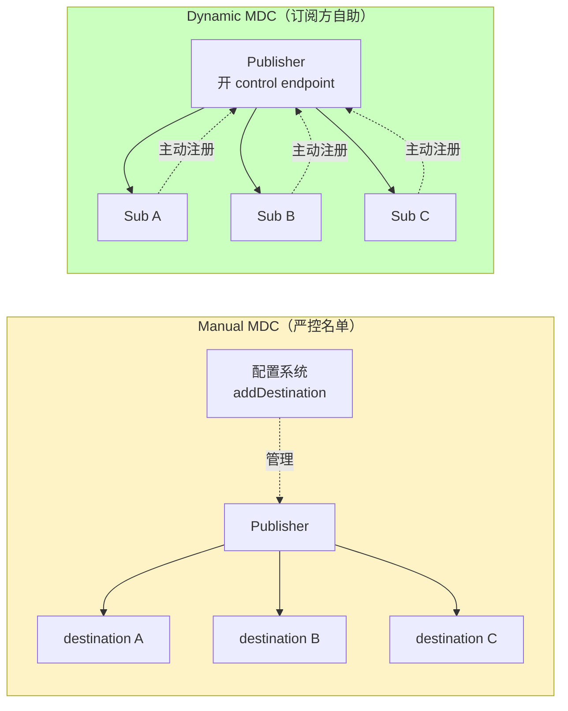

# 第 17 章 · Multi-Destination Cast（MDC）

## 学习目标

- 理解 Aeron MDC 的定位：单点发布 → 多点单播；
- 学会 manual / dynamic 两种 MDC 模式的配置；
- 会画 MDC 的 wire diagram；
- 明白 MDC 与组播的取舍。

## 本章速览：manual vs dynamic



**选择**：内部审计场景选 manual；行情/公开广播场景选 dynamic。

## 17.1 MDC 是什么

**Multi-Destination Cast** = "Publisher 一份数据，发到 N 个单播目的地"。

```
                ┌──────▶ Sub A (unicast)
Publisher ─────┼──────▶ Sub B (unicast)
                └──────▶ Sub C (unicast)
```

从订阅方看，就是普通的 unicast；从 Publisher 侧看，driver 内部把同一份数据发给多个目的地。

## 17.2 与组播的对比

| 维度 | Multicast | MDC |
|---|---|---|
| 网络支持 | 需要 IGMP / 路由 | 走普通 UDP |
| 云环境 | 大多不支持 | ✔ 完全兼容 |
| 订阅方数量 | 无上限（交换机限制） | ~几十到上百 |
| 每包成本 | 1 个 UDP 包 | N 个 UDP 包（每个目的地一份） |
| Flow control | 组播 fc 策略 | 独立单播流控 |
| 适合 | LAN 大规模广播 | 云上 / 少量订阅方 / 跨路由 |

## 17.3 两种 MDC 模式

### 17.3.1 Manual MDC

Publisher 侧写死目的地列表（订阅方不会自动加入）：

```java
String channel = "aeron:udp?control-mode=manual";
Publication pub = aeron.addPublication(channel, 1001);

// 手动加目的地
pub.addDestination("aeron:udp?endpoint=10.0.0.10:40456");
pub.addDestination("aeron:udp?endpoint=10.0.0.11:40456");

// 也可以运行时删
pub.removeDestination("aeron:udp?endpoint=10.0.0.10:40456");
```

用于严格控制订阅列表的场景。

### 17.3.2 Dynamic MDC

Publisher 开一个 **control endpoint**，Subscriber 主动来注册：

Publisher：

```java
String channel = "aeron:udp?control=10.0.0.5:41000|control-mode=dynamic";
Publication pub = aeron.addPublication(channel, 1001);
```

Subscriber：

```java
String channel = "aeron:udp?endpoint=10.0.0.10:40456|control=10.0.0.5:41000";
Subscription sub = aeron.addSubscription(channel, 1001);
```

Aeron 内部会：
1. Subscriber 联系 control endpoint；
2. Publisher 把 subscriber 的 endpoint 加入目的地列表；
3. Publisher 开始把数据 unicast 到该 endpoint。

## 17.4 一段可运行示例（dynamic）

Publisher：

```java
try (MediaDriver driver = MediaDriver.launchEmbedded();
     Aeron aeron = Aeron.connect(new Aeron.Context()
             .aeronDirectoryName(driver.aeronDirectoryName()));
     Publication pub = aeron.addPublication(
             "aeron:udp?control=127.0.0.1:41000|control-mode=dynamic", 1001)) {

    while (!pub.isConnected()) Thread.sleep(10);
    // ... offer 循环
}
```

Subscriber A：

```java
Subscription subA = aeron.addSubscription(
    "aeron:udp?endpoint=127.0.0.1:40456|control=127.0.0.1:41000", 1001);
```

Subscriber B（另一台机器或不同端口）：

```java
Subscription subB = aeron.addSubscription(
    "aeron:udp?endpoint=127.0.0.1:40457|control=127.0.0.1:41000", 1001);
```

Publisher 只需要 offer 一次，driver 自动把包发到 40456 和 40457。

## 17.5 何时选 manual、何时 dynamic

| 选 manual | 选 dynamic |
|---|---|
| 订阅方列表由配置系统管理 | 订阅方动态上下线 |
| 需要审计 / 权限控制 | 内部信任网络 |
| Cluster 的 leader → followers 广播 | 行情分发到多个策略 |

## 17.6 MDC + Flow Control

MDC 的 Publisher 会为每个目的地维护独立的 flow control（不是组播的 min/max）。因此：

- 一个订阅方慢，不影响其他订阅方（只影响 Publisher 到该 endpoint 的进度）；
- 但如果 term-length 有限，最慢的 endpoint 也会拖 Publisher 的整体位置。

## 17.7 与 Archive 的组合

MDC 常和 Aeron Archive 搭配：

```
Publisher ─┬─▶ Sub A (业务消费)
           ├─▶ Sub B (业务消费)
           └─▶ Archive Recorder (持久化)
```

新加入的订阅方可以用 replay-merge（Ch20）从 Archive 补齐历史。

## 17.8 常见陷阱

1. **忘记 `control-mode=dynamic`**：Publisher 不会接收动态注册。
2. **control endpoint 与 endpoint 混淆**：control 是"注册端"，endpoint 是"数据端"。
3. **NAT 穿透**：dynamic MDC 需要订阅方能主动连到 Publisher control endpoint。
4. **manual 模式忘记 addDestination**：Publisher 有数据但没人收。
5. **destination 掉线不清理**：可能触发 unblock；manual 模式要主动 removeDestination。

## 17.9 小结

- MDC = 单播的 1:N 版本，云原生友好；
- 生产选 dynamic MDC 多，manual 用于强控场景；
- 与 Archive 组合是"新订阅方补历史"的标准套路。
