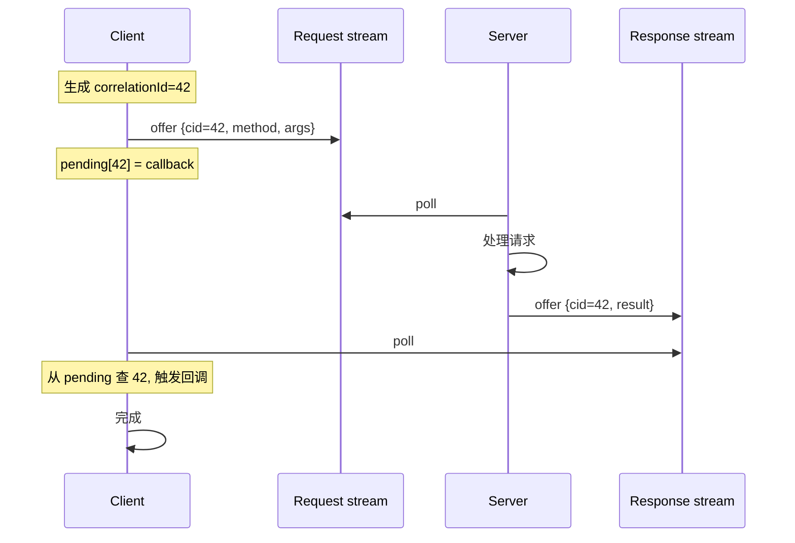

# 第 18 章 · Request / Response 模式

## 学习目标

- 明白 Aeron 天生是 pub/sub，没有内建 request/response；
- 学会用双向 stream 实现 req/resp；
- 了解 aeron-cookbook 中的 request/response 模式；
- 掌握 correlationId + reply channel 的思路。

## 本章速览：双向 stream + correlationId



**核心**：Aeron 只提供单向 pub/sub，双向靠"两条 stream + correlationId 关联"。

## 18.1 Aeron 没有内建 RPC

Aeron 只提供单向 pub/sub。想做 RPC 要业务层组合：

```
Client ─── requestChannel   ───▶ Server
Client ◀── responseChannel  ─── Server
```

## 18.2 常见拓扑

### 18.2.1 共享 response channel

所有 client 共用一个 response channel（比如 `aeron:ipc?stream=response`），用 `correlationId` 区分：

```
Request: {correlationId, method, args}
Response: {correlationId, result}
```

优点：channel 少；缺点：所有 client 收到别人的 response（要过滤）。

### 18.2.2 per-client response channel

每个 client 用不同的 sessionId 或 endpoint 作为 reply-to：

```
Request: {correlationId, method, args, replyToChannel, replyToStreamId}
Server 收到后 addPublication(replyToChannel, replyToStreamId) 发回。
```

对 UDP：每个 client 有独立 endpoint；对 IPC：用不同 streamId。

## 18.3 CorrelationId 生成

- 单进程：`AtomicLong`；
- 分布式：`(nodeId << 48) | localCounter`；
- Aeron 内部：`Aeron.nextCorrelationId()` 保证同一 driver 内递增。

## 18.4 一个 IPC 示例

Client：

```java
Publication req = aeron.addPublication("aeron:ipc", REQUEST_STREAM);
Subscription resp = aeron.addSubscription("aeron:ipc", RESPONSE_STREAM);

long correlationId = ...;
UnsafeBuffer buf = new UnsafeBuffer(ByteBuffer.allocateDirect(64));
buf.putLong(0, correlationId);
buf.putInt(8, methodId);
// ... args
req.offer(buf, 0, 64);

// 用一个 map 记录 pending
pending.put(correlationId, callback);

// poll response，按 correlationId dispatch
resp.poll((buffer, offset, length, header) -> {
    long cid = buffer.getLong(offset);
    Consumer<DirectBuffer> cb = pending.remove(cid);
    if (cb != null) cb.accept(buffer);
}, 10);
```

Server：

```java
Subscription req = aeron.addSubscription("aeron:ipc", REQUEST_STREAM);
Publication resp = aeron.addPublication("aeron:ipc", RESPONSE_STREAM);

req.poll((buffer, offset, length, header) -> {
    long cid = buffer.getLong(offset);
    int methodId = buffer.getInt(offset + 8);
    // 处理请求
    UnsafeBuffer out = ...;
    out.putLong(0, cid);
    // ... 结果
    resp.offer(out, 0, len);
}, 10);
```

## 18.5 超时处理

request/response 一定要有超时：

```java
class Pending {
    long submittedNanos;
    Consumer<DirectBuffer> callback;
    Consumer<Throwable> onTimeout;
}

// 定时器（每 1ms 检查一次）
long deadline = System.nanoTime() - TimeUnit.SECONDS.toNanos(1);
pending.entrySet().removeIf(entry -> {
    if (entry.getValue().submittedNanos < deadline) {
        entry.getValue().onTimeout.accept(new TimeoutException());
        return true;
    }
    return false;
});
```

## 18.6 拥塞与 fairness

如果一个 client 疯狂发请求，会挤占 server 的 request stream。方案：

1. **多 stream**：VIP client 用不同 streamId，server 按优先级 poll；
2. **令牌桶**：server 侧维护 per-client 计数，超限 drop / 返回 busy；
3. **Back Pressure**：server 慢下来时 Publisher offer 会拿到 BACK_PRESSURED，client 感知。

## 18.7 aeron-cookbook 的样例

`aeron-cookbook-code` 里 `request-response` 模块用两条 channel + SBE 协议实现，值得对照阅读。核心点：

- Request/Response schema 都用 SBE；
- correlationId 是 uint64；
- Server 用一个 Long2ObjectHashMap<Session> 记录会话；
- Client 用 CompletableFuture 包装。

## 18.8 与 gRPC 的对比

Aeron RPC 优势：延迟 μs 级、二进制、零 GC；
gRPC 优势：HTTP/2 生态、metadata、跨语言、TLS。

如果你只在机房内做低延迟 RPC，Aeron 完胜；跨互联网、跨语言、需要 TLS，用 gRPC。

## 18.9 常见陷阱

1. **shared response channel 忘记过滤 correlationId**：client 收到别人的 response，NPE 一片。
2. **超时不清 pending**：内存泄漏。
3. **同步等待 response**：把整个消费循环卡住，用 CompletableFuture / callback。
4. **单一 request stream 挂了**：所有 client 都失败，考虑主备 stream 或 stream fail-over。

## 18.10 小结

- Aeron RPC = 双向 pub/sub + correlationId + pending map
- 一定要处理超时和 back pressure
- 深度参考 aeron-cookbook 的 request-response 模块
