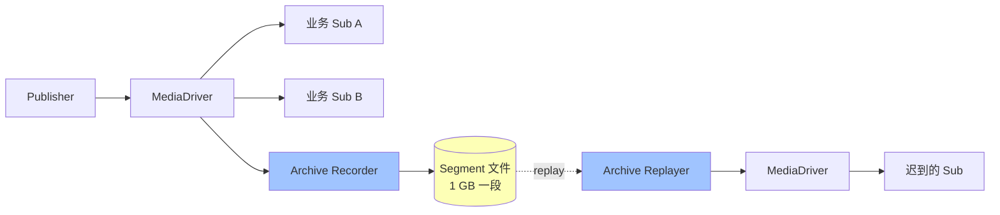
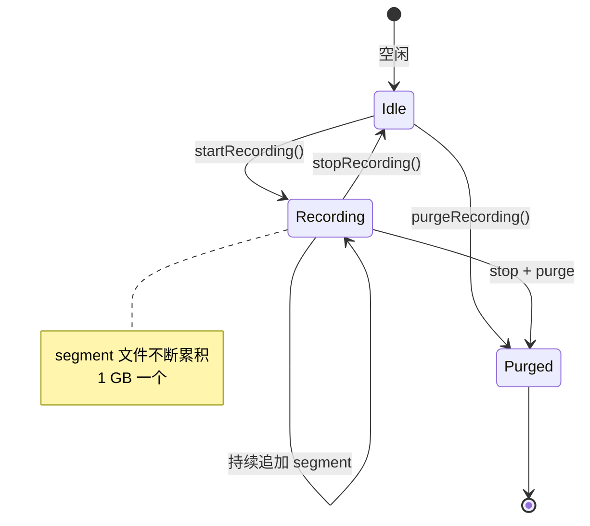

# 第 19 章 · Aeron Archive：概览与录制

## 学习目标

- 理解 Aeron Archive 的定位（不是 Kafka 替代品）；
- 学会启动一个 Archive；
- 会用 `startRecording` / `stopRecording`；
- 知道 recording 的存储布局与命名。

## 本章速览：Archive 在数据流中的位置



**记忆**：Archive 是"数据流的录像机"——旁路挂在总线上录，也能任意时刻倒放。

## 19.1 Archive 是什么

Aeron Archive = Aeron Transport 之上的"持久化 + 回放"服务。

```
Publisher ── stream ──▶ MediaDriver ─┬─▶ Subscriber (业务消费)
                                     │
                                     └─▶ Archive (录成 segment 文件)
                                            ↑
                                            └─── replay 回放
```

关键特性：
- **不是 broker**：Archive 只负责录制/回放，不做业务分发；
- **本地磁盘**：Segment 文件（默认 1 GB 一段）；
- **零拷贝 replay**：直接 mmap segment 发给订阅方；
- **通过 Aeron 通信**：Archive 客户端通过 Aeron 控制/数据 stream 与 Archive 交互。

## 19.2 Archive 的架构

```
┌──────────── Archive Process ─────────────┐
│                                          │
│  ┌────────────┐   ┌──────────────────┐   │
│  │ Recorder   │   │ Replayer         │   │
│  │ (读 sub    │   │ (从 segment 发   │   │
│  │  写 disk)  │   │  给订阅方)       │   │
│  └────────────┘   └──────────────────┘   │
│         │                    │           │
│         ▼                    ▼           │
│   /var/aeron/archive/*.segment           │
└──────────────────────────────────────────┘
         │                    │
         │ Control Channel    │ Replay Channel
         ▼                    ▼
       Aeron MediaDriver (shared)
```

## 19.3 启动 Archive（Embedded 版）

`aeron-archive` 需要额外依赖：

```xml
<dependency>
    <groupId>io.aeron</groupId>
    <artifactId>aeron-archive</artifactId>
    <version>1.44.1</version>
</dependency>
```

启动：

```java
try (MediaDriver driver = MediaDriver.launchEmbedded();
     Archive archive = Archive.launch(new Archive.Context()
             .aeronDirectoryName(driver.aeronDirectoryName())
             .archiveDir(new File("/tmp/aeron-archive"))
             .controlChannel("aeron:udp?endpoint=localhost:8010")
             .replicationChannel("aeron:udp?endpoint=localhost:0")   // for aeron cluster
             .recordingEventsEnabled(false))) {

    // driver + archive 都跑起来了
    Thread.currentThread().join();
}
```

生产上 Archive 通常独立进程（用 `ArchivingMediaDriver`）。

## 19.4 连接 Archive Client

```java
AeronArchive archive = AeronArchive.connect(new AeronArchive.Context()
    .aeron(aeron)
    .controlRequestChannel("aeron:udp?endpoint=localhost:8010")
    .controlResponseChannel("aeron:udp?endpoint=localhost:0")   // 让 driver 选端口
    .messageTimeoutNs(TimeUnit.SECONDS.toNanos(5)));
```

`archive` 就是控制 API，所有录制 / 回放操作都通过它。

## 19.5 开始录制

对某个 stream 开始录制：

```java
long subscriptionId = archive.startRecording(
    "aeron:udp?endpoint=localhost:40456",
    1001,
    SourceLocation.LOCAL);
```

`SourceLocation.LOCAL`：driver 本地已有的 stream（Publisher 就在同一 driver 上）；
`SourceLocation.REMOTE`：Archive 主动订阅远端 UDP。

Archive 会 spawn 一个 Recorder，开始把 stream 落地到 segment 文件。

## 19.6 停止录制

```java
archive.stopRecording(subscriptionId);
// 或
archive.stopRecording("aeron:udp?endpoint=...", 1001);
```

停止后 segment 会保留，直到手动 `purgeRecording()`。

## 19.7 列出录制信息

```java
archive.listRecordings(0, Integer.MAX_VALUE, (
    controlSessionId, correlationId, recordingId,
    startTimestamp, stopTimestamp, startPosition, stopPosition,
    initialTermId, segmentFileLength, termBufferLength, mtuLength,
    sessionId, streamId, strippedChannel, originalChannel, sourceIdentity) -> {

    log.info("recordingId={} channel={} streamId={} pos={}..{}",
        recordingId, originalChannel, streamId, startPosition, stopPosition);
});
```

或者按 URI 查询：

```java
archive.listRecordingsForUri(0, Integer.MAX_VALUE,
    "aeron:udp?endpoint=localhost:40456", 1001, callback);
```

## 19.8 录制生命周期



## 19.9 Segment 文件布局

```
/tmp/aeron-archive/
├── archive.catalog                  记录信息目录（recording metadata）
├── 0-0.rec                          recordingId=0, segment#0, 1 GB
├── 0-1073741824.rec                 recordingId=0, segment#1
└── 1-0.rec                          recordingId=1, segment#0
```

Segment 文件本质就是 term buffer 的连续快照 + Aeron header。

## 19.10 存储管理

Archive 的存储不是无限的，需要主动管理：

```java
archive.purgeRecording(recordingId);        // 删除某个 recording 全部 segment
archive.truncateRecording(recordingId, position);  // 只保留到某个 position
```

生产建议：
- 定时把老 recording 移到 S3 / 归档存储；
- 只保留最近 N 小时在本地；
- 用 SSD，segment 顺序写吞吐能到 GB/s。

## 19.11 一个可运行示例

```java
try (MediaDriver driver = MediaDriver.launchEmbedded();
     Archive archive = Archive.launch(new Archive.Context()
             .aeronDirectoryName(driver.aeronDirectoryName())
             .archiveDir(new File("/tmp/aeron-archive-demo"))
             .controlChannel("aeron:ipc")                             // IPC 简化
             .replicationChannel("aeron:ipc"));
     Aeron aeron = Aeron.connect(new Aeron.Context()
             .aeronDirectoryName(driver.aeronDirectoryName()));
     AeronArchive ac = AeronArchive.connect(new AeronArchive.Context()
             .aeron(aeron)
             .controlRequestChannel("aeron:ipc")
             .controlResponseChannel("aeron:ipc"))) {

    long subId = ac.startRecording("aeron:ipc?alias=marketdata", 1001, SourceLocation.LOCAL);

    // 正常发消息（会被 Archive 顺带录到磁盘）
    Publication pub = aeron.addPublication("aeron:ipc?alias=marketdata", 1001);
    UnsafeBuffer buf = new UnsafeBuffer(ByteBuffer.allocateDirect(64));
    for (int i = 0; i < 1000; i++) {
        buf.putLong(0, System.nanoTime());
        while (pub.offer(buf, 0, 8) < 0) Thread.yield();
    }
    Thread.sleep(500);
    ac.stopRecording(subId);
}
```

跑完后 `/tmp/aeron-archive-demo/` 里能看到 segment 文件。

## 19.12 常见陷阱

1. **忘记 replicationChannel**：Cluster 或 replicate 场景会报错，就算不用也建议指定。
2. **磁盘满**：Archive 会停止录制，Publisher 侧变 BackPressure。
3. **Archive 与业务 driver 混用同一 aeronDir**：可以，但要注意 segment 对磁盘 IO 的影响。
4. **控制通道错**：controlRequestChannel / controlResponseChannel 双方要匹配。

## 19.13 小结

- Archive = 录制 + 回放服务，不是 broker
- startRecording / stopRecording 是核心命令
- 下一章讲 Replay 与 Replay-Merge（迟到订阅方补历史）
