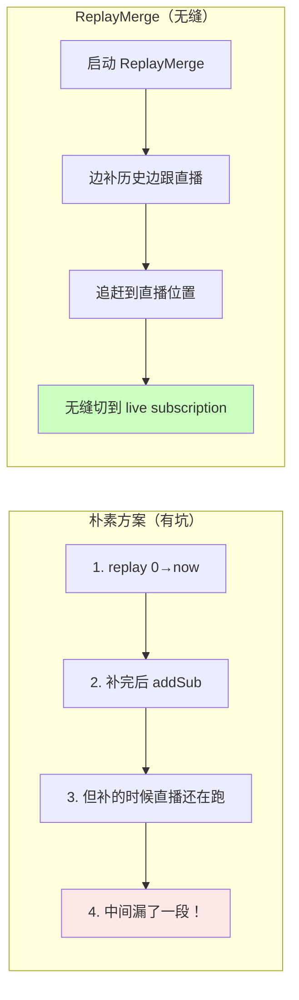
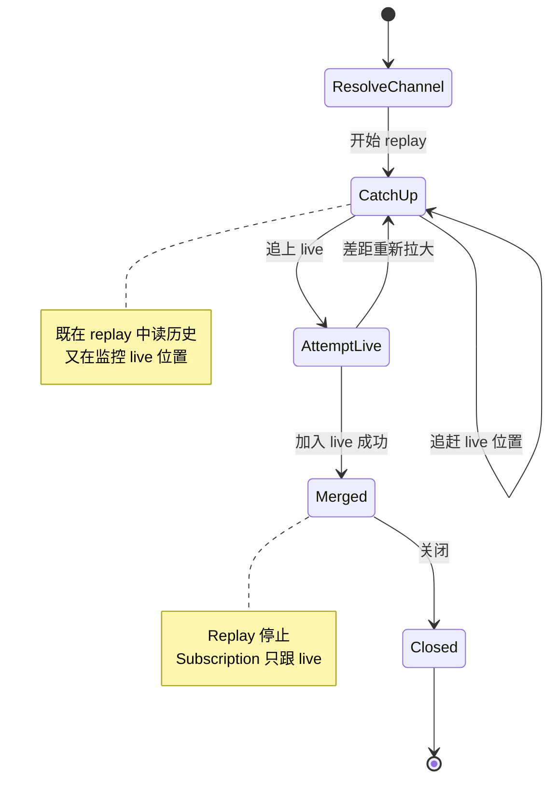

# 第 20 章 · Replay / Replay-Merge / Live Merge

## 学习目标

- 学会 `replay` / `startReplay` / `replayMerge` 三种回放 API；
- 明白 Replay-Merge 如何解决"新订阅方追赶实时流"问题；
- 掌握 replay 与 live subscription 的 sessionId / position 对齐；
- 认识 aeron-cookbook 里 `archive-replay-merge` 的骨架。

## 本章速览：为什么需要 Replay-Merge



## 20.1 三种回放 API

| API | 语义 |
|---|---|
| `replay(recordingId, position, length, replayChannel, replayStreamId)` | 从 recording 回放一段数据到某个 stream |
| `startReplay(...)` | 同上，但返回 replaySessionId，可后续 `stopReplay` |
| `replayMerge` | 从 Archive 回放 + 无缝切到实时流（关键！） |

## 20.2 简单 Replay

```java
long replaySessionId = archive.startReplay(
    recordingId,
    /*position*/ 0L,
    /*length*/ Long.MAX_VALUE,
    "aeron:ipc?alias=replay",    // 回放 stream
    2001);
```

回放会：
1. Archive 起一个 Publisher 到 `aeron:ipc?alias=replay stream=2001`；
2. 从 segment 文件按顺序读，emit 给这个 Publisher；
3. 业务在这个 stream 上加 Subscription 就能收到。

停止回放：

```java
archive.stopReplay(replaySessionId);
```

## 20.3 Replay-Merge 是什么

**问题**：一个"迟到的订阅方"想收实时流，但它从 position=0 开始订阅会漏掉几个小时的历史 → 需要先"从 Archive 补历史，然后无缝切到实时流"。

**普通做法（有坑）**：
1. `replay(0, currentPos)` 补历史；
2. 补完再 addSubscription 收实时。
3. 但补历史期间实时流还在跑 → 补完的 currentPos 已经落后了。

**Replay-Merge 做法**：Aeron 自动处理"追赶 → 无缝切换"：

```java
ReplayMerge merge = new ReplayMerge(
    subscription,                              // 目标业务 subscription
    archive,                                   // AeronArchive client
    "aeron:udp?endpoint=archive-host:8020",    // replay 控制目的
    "aeron:udp?endpoint=me:0",                 // replay 发到我这里的 endpoint
    "aeron:udp?endpoint=publisher-host:40456", // live channel
    recordingId,
    /*startPos*/ 0L);

while (!merge.isMerged()) {
    int fragments = merge.poll(handler, 10);
    idleStrategy.idle(fragments);
}
// merge 后 subscription 就变成"直播 + 已消费历史"
```

### 20.3.1 内部状态机

```
STATE_CATCH_UP     ← replay 从 startPos 追到 live position
STATE_ATTEMPT_LIVE ← 尝试加入 live channel
STATE_MERGED       ← replay stop，subscription 只跟 live
STATE_CLOSED
```



在切换的过程中，Aeron 保证消息 **不重不漏**，通过对齐 sessionId 和 position 实现。

## 20.4 一段可运行示例

```java
// 假设 Archive 已录制 recordingId=42，channel=aeron:udp?endpoint=srv:40456, streamId=1001

Subscription sub = aeron.addSubscription("aeron:udp?endpoint=srv:40456", 1001);

ReplayMerge merge = new ReplayMerge(
    sub,
    archive,
    "aeron:udp?endpoint=archive:8020",
    "aeron:udp?endpoint=" + localHost + ":0",
    "aeron:udp?endpoint=srv:40456",
    42,
    0);

FragmentHandler handler = (buf, off, len, hdr) -> {
    log.info("collected pos={} len={}", hdr.position(), len);
};

while (running && !merge.isClosed()) {
    int f = merge.poll(handler, 20);
    idle.idle(f);
    if (merge.isMerged()) {
        log.info("已合并直播流");
        break;
    }
}
// merge.close() 后 subscription 可以继续作为普通 live subscription 用
```

## 20.5 Bounded Replay

有时候不想回放全部，只回放到某个 position：

```java
image.boundedPoll(handler, endPos, 10);
```

或用 Archive 的 replay 接口指定 length：

```java
archive.startReplay(recId, startPos, endPos - startPos, replayChannel, streamId);
```

## 20.6 Replicate（跨 Archive 复制）

Archive 之间可以互相复制 recording（比如主备 Archive）：

```java
long correlationId = archive.replicate(
    /*srcRecordingId*/ 42,
    /*dstRecordingId*/ Aeron.NULL_VALUE,
    /*srcControlStreamId*/ 10,
    /*srcControlChannel*/ "aeron:udp?endpoint=archive-a:8010",
    /*liveDestination*/ null);
```

## 20.7 sessionId 对齐

Replay-Merge 的关键难点：Archive 回放出来的 sessionId 与 live Publisher 的 sessionId 不同。Aeron 通过：

1. Replay 的 Publication 使用 **原始 recording 的 sessionId**（Archive 会 spoof）；
2. Subscription 在同一 (channel, streamId, sessionId) 下把两条 Image 合并；
3. 位置对齐 → 一致的消息序列。

这就是为什么 replay-merge 只对 **同一 recording** 有意义。

## 20.8 常见陷阱

1. **忘记 startRecording 就 replay**：报 unknown recordingId。
2. **replay endpoint 与 live endpoint 冲突**：merge 会失败。
3. **live subscription 已经 add 但没 add publication 同 sessionId**：driver 认为不 connected。
4. **replay 太快 term 满**：加大 term-length 或降 replay 速率（有 `replayBlockLength`）。
5. **磁盘 IO 不够快**：replay throughput 上限受 SSD 影响。

## 20.9 与 Cluster 的关系

Cluster 里的每个节点都有本地 Archive；leader 变更时新 leader 通过 Archive replay + replicate 追赶落后节点。Part VII 会看到细节。

## 20.10 小结

- Replay = 从 Archive 拉历史；Replay-Merge = 拉完历史无缝切实时
- Replay-Merge 是 Aeron 生态里最有价值的 pattern 之一
- Cluster 之所以能做到 Raft 恢复，就是靠 Archive replay
