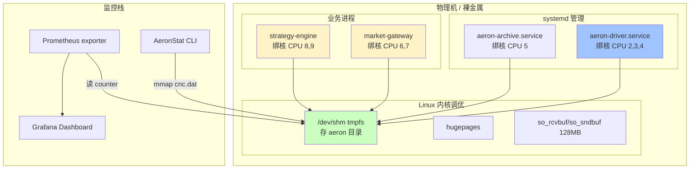

# 第 23 章 · 部署、监控、性能调优

## 学习目标

- 学会独立部署 MediaDriver / Archive 的 systemd unit；
- 掌握 Linux 上的核心 tuning：hugepages、tmpfs、绑核；
- 会做基准测试，识别延迟瓶颈；
- 掌握生产必备的监控指标。

## 本章速览：生产部署拓扑



## 23.1 独立部署 MediaDriver

`/etc/systemd/system/aeron-driver.service`：

```ini
[Unit]
Description=Aeron Media Driver
After=network.target

[Service]
Type=simple
User=aeron
Group=aeron
LimitNOFILE=100000
LimitMEMLOCK=infinity
Environment="JAVA_HOME=/usr/lib/jvm/java-21-openjdk"
ExecStart=/usr/lib/jvm/java-21-openjdk/bin/java \
    -Xms1g -Xmx1g \
    -XX:+AlwaysPreTouch \
    -XX:+UseNUMA \
    -Daeron.dir=/dev/shm/aeron-prod \
    -Daeron.threading.mode=DEDICATED \
    -Daeron.mtu.length=8192 \
    -Daeron.term.buffer.length=16777216 \
    -Daeron.ipc.term.buffer.length=16777216 \
    -jar /opt/aeron/aeron-driver.jar
Restart=always
RestartSec=1

[Install]
WantedBy=multi-user.target
```

启动：

```bash
sudo systemctl daemon-reload
sudo systemctl enable --now aeron-driver
journalctl -u aeron-driver -f
```

## 23.2 Aeron Java 属性

除了 Context API，Aeron 也允许通过 `-Daeron.*=value` 配置，方便运维改配置不改代码。常用：

```
-Daeron.dir=/dev/shm/aeron-prod
-Daeron.threading.mode=DEDICATED
-Daeron.mtu.length=8192
-Daeron.term.buffer.length=16777216
-Daeron.ipc.term.buffer.length=16777216
-Daeron.client.liveness.timeout=10000000000     # 10 s
-Daeron.publication.unblock.timeout=15000000000
-Daeron.socket.so_sndbuf=2097152
-Daeron.socket.so_rcvbuf=2097152
```

## 23.3 Linux 核心 tuning

### 23.3.1 tmpfs 存 aeron dir

```bash
mount -t tmpfs -o size=8g tmpfs /dev/shm/aeron-prod
```

避免磁盘 IO 干扰 shared memory。

### 23.3.2 UDP socket buffer

```bash
sysctl -w net.core.rmem_max=134217728
sysctl -w net.core.wmem_max=134217728
sysctl -w net.core.rmem_default=134217728
sysctl -w net.core.wmem_default=134217728
sysctl -w net.core.netdev_max_backlog=10000
```

### 23.3.3 Huge Pages

对超大 term buffer 有帮助（>= 256 MB）：

```bash
echo 512 > /proc/sys/vm/nr_hugepages
mount -t hugetlbfs nodev /dev/hugepages
```

Aeron 目前不直接支持 hugetlbfs，但 JVM 用 `-XX:+UseLargePages` 可以获得部分收益。

### 23.3.4 绑核 / isolcpus

BIOS 关闭 hyperthreading（或用 SMT sibling 隔离）。GRUB：

```
isolcpus=2,3,4,5 nohz_full=2,3,4,5 rcu_nocbs=2,3,4,5
```

启动时 `taskset -c 2 java -jar aeron-driver.jar`。
线程内部用 `Affinity.setAffinity(...)`（`net.openhft:affinity`）。

## 23.4 JVM 参数

低延迟 Aeron 应用推荐：

```
-Xms4g -Xmx4g                            # 固定堆
-XX:+AlwaysPreTouch                      # 预分配堆
-XX:+UseZGC                              # 或 Shenandoah / G1
-XX:MaxGCPauseMillis=1                   # 目标 pause
-XX:-UsePerfData                         # 关闭 hsperfdata
-XX:+DisableExplicitGC                   # 忽略 System.gc()
-Djava.util.concurrent.ForkJoinPool.common.parallelism=1
```

高频交易场景可能改成 Epsilon GC（不回收，服务重启前跑几小时）。

## 23.5 基准测试

Aeron 自带 `EmbeddedThroughput` / `Latency` samples：

```bash
# 吞吐
java -cp aeron-samples-all.jar io.aeron.samples.EmbeddedThroughput

# RTT 延迟
java -cp aeron-samples-all.jar io.aeron.samples.Ping
java -cp aeron-samples-all.jar io.aeron.samples.Pong
```

自定义 benchmark 用 JMH + HdrHistogram：

```java
HdrHistogram histogram = new Histogram(TimeUnit.SECONDS.toNanos(10), 3);
for (int i = 0; i < 10_000_000; i++) {
    long t0 = System.nanoTime();
    // do work
    histogram.recordValue(System.nanoTime() - t0);
}
histogram.outputPercentileDistribution(System.out, 1.0);
```

关注 P50 / P99 / P99.99。

## 23.6 常见延迟数字（参考）

**直观量级图**：

```
路径                       中位数    ▁▂▃▅▆▇█
─────────────────────────────────────────────────
IPC 8 字节 one-way          200ns   ▁
IPC 64 字节 one-way         600ns   ▁
UDP LAN 10GbE               8μs     ▃
UDP LAN 1GbE                15μs    ▅
gRPC LAN                    500μs   ▇
Kafka                       5ms     █

同一台机器 → 用 IPC   跨机 → 用 UDP + 10GbE
```


| 场景 | 中位数 | P99 |
|---|---|---|
| IPC 8-byte one-way | 200~500 ns | 1~5 μs |
| IPC 64-byte one-way | 500 ns~1 μs | 5~10 μs |
| UDP LAN 1 GbE | 5~20 μs | 20~50 μs |
| UDP LAN 10 GbE | 3~10 μs | 15~30 μs |
| UDP LAN 25 GbE + kernel bypass | <5 μs | <15 μs |

超出这些数字 2x 以上就要开始 profile。

## 23.7 监控指标

必须监控的 counter：

| Counter | 阈值建议 |
|---|---|
| `bytes_sent` / `bytes_received` | 波动异常 |
| `publisher_back_pressured` | 每秒增长 > 100 |
| `publisher_unblock` | 出现即告警 |
| `loss_gap_fills` | 每秒 > 0 就要看 |
| `loss report file` | 出现新条目告警 |
| `errors` | > 0 告警 |
| `sub-pos vs pub-pos` | 差距 > 1 MB 告警 |

工具：Prometheus exporter 有社区实现（`aeron-agent` 里也有）。

## 23.8 常见性能陷阱

1. **term buffer 太小**：BackPressure 频繁。
2. **Publisher 每次 offer 前 log.info**：日志阻塞主线程。
3. **多个 Aeron client 复用一个线程 poll 但没设 IdleStrategy**：CPU 100%。
4. **JIT 未 warmup 就跑正式流量**：前几分钟延迟 10 倍。
5. **GC 未调优**：ZGC 之前用 G1，Full GC pause 秒级。
6. **忘了 `PreTouch`**：第一次访问堆页产生 page fault。
7. **kernel version 老**：< 5.4 的 UDP 性能有 bug。

## 23.9 日志建议

- **不要**在热路径打日志，或者用 log4j2 async + gc-free；
- 使用 `LOG.isDebugEnabled()` guard；
- 生产日志级别 INFO 及以上，把 `io.aeron` 压到 WARN。

## 23.10 小结

- 独立部署 MediaDriver，systemd 管
- tmpfs + hugepage + 绑核是 Linux 侧三板斧
- JVM 用 ZGC + AlwaysPreTouch
- 监控 counter 是排障基础
