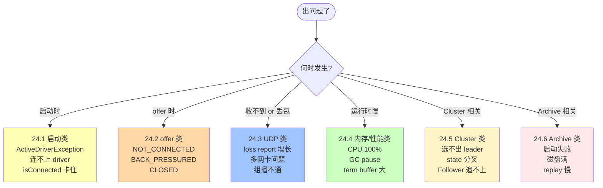

# 第 24 章 · 常见错误与排错手册

按现象归类，每条给出诊断步骤和常见修复。

## 本章速览：排错决策树



**排错心法**：先看 counter（`AeronStat`）→ 再看 driver 日志 → 最后看业务代码。别一上来 review 业务代码。

## 24.1 启动类

### 24.1.1 `ActiveDriverException`

**现象**：`java.io.IOException: ActiveDriverException: driver active`。

**原因**：同一目录已经有 driver 在跑，或者上次没关干净留下的 pidfile。

**修复**：
```bash
# 1) 确认没有别的 driver 进程
ps aux | grep -i mediadriver

# 2) 删掉残留目录
rm -rf /tmp/aeron-$USER

# 3) 或用 launchEmbedded() 生成新目录
# 4) Context 里加 .dirDeleteOnStart(true)
```

### 24.1.2 `AeronException: Aeron client is closed`

**原因**：Aeron client 已经 `close()`，还在用 pub/sub 引用。

**修复**：检查生命周期。try-with-resources 是最简单的方式，也可以给 Aeron.Context 设 `errorHandler` 排查。

### 24.1.3 一直卡在 `!publication.isConnected()`

**原因**：
1. Publisher 与 Subscription 的 (channel, streamId) 不完全一致（比如 URI 多了一个空格）；
2. Publisher 与 Subscription 连的不是同一个 driver（aeronDirectoryName 不匹配）；
3. UDP 端口被防火墙拦；
4. UDP endpoint 在 subscriber 端没绑对 IP。

**排查**：
```java
System.out.println(pub.channel() + " " + pub.streamId());
System.out.println(sub.channel() + " " + sub.streamId());
```
两个 print 出来必须完全一致（连引号里空格都要）。

## 24.2 offer 类

### 24.2.1 一直 NOT_CONNECTED (-1)

**原因**：Subscriber 还没上线；或 UDP 的 SM 没到。

**修复**：先 sleep 等 `isConnected()` 变 true 再 offer；或者容忍前几秒的失败。

### 24.2.2 频繁 BACK_PRESSURED (-2)

**原因**：消费者跟不上。

**排查顺序**：
1. Handler 里做了慢操作（sleep、log、锁）？→ 立刻修。
2. term-length 太小 → 加大到 16MB / 32MB。
3. 消费者 IdleStrategy 太懒（SleepingIdleStrategy(10ms)）？→ 换 BackoffIdleStrategy。
4. UDP 场景 SM 太慢？→ `ctx.statusMessageTimeoutNs(...)` 调短。

### 24.2.3 CLOSED (-4)

**原因**：Publication 已 close。**修复**：检查代码，别在关闭后继续 offer。

### 24.2.4 MAX_POSITION_EXCEEDED (-5)

**原因**：Publisher 的 stream 位置耗尽（`2^63 / term_length`）。

**修复**：新建 Publication；重启进程。生产环境不太可能遇到（term_length=16M 时能撑 500 亿年）。

## 24.3 UDP 类

### 24.3.1 部分包丢失（loss report 增长）

**原因**：网络丢包 or 消费者太慢导致 term 覆盖。

**修复**：
- 加大 term-length（NAK 窗口更大）
- 增加 socket buffer（`so_rcvbuf`）
- 检查 MTU 是否两端一致

### 24.3.2 多网卡时 subscriber 收不到

**修复**：URI 里显式指定 `interface=<local-ip>`。

### 24.3.3 组播不通

**排查**：
```bash
# 加入组的网卡对不对
netstat -g

# 交换机 IGMP snooping 是否放行
tcpdump -i eth0 -n dst 239.x.y.z
```

## 24.4 内存 / 性能类

### 24.4.1 term buffer 文件很大

**原因**：每个 Publication.log 是 3 × term-length。默认 term=16 MB → 48 MB / publication。

**修复**：改用 `.ipcPublicationTermBufferLength(4 MB)`，或减少 publisher 数量。

### 24.4.2 driver CPU 100%

**原因**：ThreadingMode=DEDICATED + NoOpIdleStrategy，绑核了没？没绑核就是抢别人 CPU。

**修复**：`taskset -c N,N+1,N+2 java ...`。

### 24.4.3 GC pause 拖高 P99

**原因**：业务代码有分配、log 不 gc-free、Assembler 扩容...

**修复**：
- ZGC / Shenandoah；
- log4j2 async layout + gc-free pattern；
- 排查 UnsafeBuffer 使用是否复用。

## 24.5 Cluster 类

### 24.5.1 节点选不出 leader

**原因**：
- clusterMembers 端口写错，节点间通信不通；
- 时钟严重不同步。

**排查**：`journalctl -u aeron-cluster` 看 role 变化日志。

### 24.5.2 Follower 追赶不上

**原因**：磁盘 replay 太慢，或 log 太长又没 snapshot。

**修复**：调低 snapshot 间隔；用更快 SSD；减少 snapshot 大小。

### 24.5.3 Service state 分叉

**原因**：Service 里用了非确定性 API（Random、currentTimeMillis）。

**修复**：全部换成 `cluster.time()` / 请求里带随机数。

## 24.6 Archive 类

### 24.6.1 startRecording 返回 -1 或抛异常

**原因**：controlChannel 没连上，或 stream 不存在。

**修复**：先确认 Archive 已启动、control channel 通。

### 24.6.2 磁盘写满

**修复**：`purgeRecording` 或迁移到冷存储。生产用 alert 提前警告。

### 24.6.3 Replay 特别慢

**原因**：磁盘 IO 慢，或 replay stream MTU 小。

**修复**：SSD，或加大 replay channel 的 MTU。

## 24.7 通用调试技巧

1. **打开 debug log**：`-Daeron.event.log=all -Daeron.event.log.output.filename=/tmp/aeron-events.log`
2. **AeronStat 实时看 counter**（Ch15）
3. **cnc 反解**：`java -cp aeron-agent.jar io.aeron.agent.EventLogAgent ...`
4. **`errorHandler`**：Aeron.Context / Archive.Context / ClusteredServiceContainer.Context 都可以设，务必打印 stacktrace。

## 24.8 排错心法

- **先看 counter，再看 log**：AeronStat 比日志更能反映真相；
- **减法调试**：把 IdleStrategy 换成 SleepingIdle(1s) 也能收 → 说明业务不忙，问题在别处；
- **单机复现**：先用 IPC 排除网络问题；
- **对齐版本**：aeron-driver / aeron-client / aeron-archive 版本必须完全一致。

## 24.9 小结

- 排错先看 counter → 再看 log → 最后看代码
- 大多数问题落在 (channel, streamId) 不匹配、term 太小、IdleStrategy 不当
- Cluster 独有的雷是 "非确定性 service"
