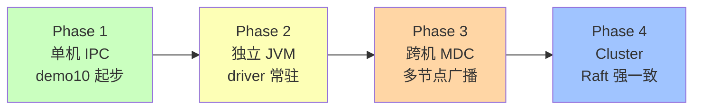
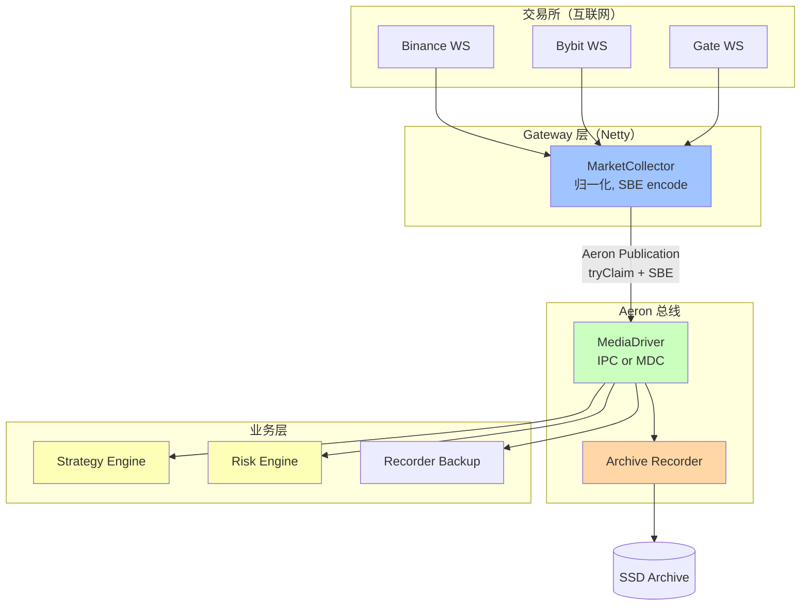

# 第 25 章 · 综合案例：低延迟行情总线

## 学习目标

- 把前 24 章的所有概念串起来做一个可运行系统；
- 学习端到端的低延迟系统组织方式：Netty ↔ Aeron ↔ Business ↔ Archive；
- 拿到一份可以直接改造为生产版本的骨架。

## 本章速览：4 步演进路线



**目标架构（Phase 4）**：



## 25.1 目标系统

```
     Binance / Bybit / Gate WebSocket
              (跨互联网, Netty)
                     │
                     ▼
        ┌─────────────────────┐
        │  MarketCollector    │  Netty client + 归一化
        │   (每交易所一个)     │
        └────────┬────────────┘
                 │ Aeron Publication (SBE MarketTick)
                 │
        ┌────────▼────────────┐
        │  Aeron MediaDriver  │  IPC + MDC
        └────────┬────────────┘
                 │
        ┌────────┴────────────────────────────┐
        │        Aeron Subscriptions          │
        │        (广播语义)                    │
        └────┬──────────────┬────────────────┘
             │              │
        ┌────▼───┐    ┌─────▼─────┐    ┌─────────────┐
        │Strategy│    │  Risk     │    │  Archive     │
        │Engine  │    │  Engine   │    │  Recorder    │
        └────────┘    └───────────┘    └──────────────┘
```

## 25.2 消息 schema（SBE）

`market-data.xml`：

```xml
<sbe:message name="MarketTick" id="100">
    <field name="timestamp"  id="1" type="int64"/>
    <field name="symbolId"   id="2" type="int32"/>
    <field name="bidPrice"   id="3" type="int64"/>
    <field name="askPrice"   id="4" type="int64"/>
    <field name="bidSize"    id="5" type="int32"/>
    <field name="askSize"    id="6" type="int32"/>
    <data name="exchange"    id="7" type="varAsciiEncoding"/>
</sbe:message>
```

Publisher 侧生成 `MarketTickEncoder`，Consumer 侧用 `MarketTickDecoder`。

## 25.3 Collector 骨架

```java
public class MarketCollector {

    private final ExclusivePublication publication;
    private final BufferClaim claim = new BufferClaim();
    private final MessageHeaderEncoder header = new MessageHeaderEncoder();
    private final MarketTickEncoder encoder = new MarketTickEncoder();
    private final Long2ObjectHashMap<Integer> symbolIdCache = new Long2ObjectHashMap<>();
    private final IdleStrategy idle = new BackoffIdleStrategy(
        100, 10, TimeUnit.MICROSECONDS.toNanos(1), TimeUnit.MICROSECONDS.toNanos(100));

    public MarketCollector(Aeron aeron, String channel, int streamId) {
        this.publication = aeron.addExclusivePublication(channel, streamId);
        while (!publication.isConnected()) idle.idle(0);
    }

    /** Netty EventLoop 里收到一条归一化的行情后调用 */
    public void onTick(NormalizedTick tick) {
        int len = MessageHeaderEncoder.ENCODED_LENGTH + MarketTickEncoder.BLOCK_LENGTH
                + MarketTickEncoder.exchangeHeaderLength() + tick.exchange.length();

        long r;
        while ((r = publication.tryClaim(len, claim)) < 0) {
            handleOfferFailure(r);
        }

        encoder.wrapAndApplyHeader(claim.buffer(), claim.offset(), header)
               .timestamp(tick.timestampNanos)
               .symbolId(symbolIdCache.getOrDefault(tick.symbolHash, -1))
               .bidPrice(tick.bidPriceRaw)
               .askPrice(tick.askPriceRaw)
               .bidSize(tick.bidSize)
               .askSize(tick.askSize)
               .exchange(tick.exchange);
        claim.commit();
    }

    private void handleOfferFailure(long r) {
        if (r == Publication.BACK_PRESSURED) {
            metrics.backPressured.increment();
            // 策略：丢弃老 tick，业务上可以接受
            return;
        }
        if (r == Publication.NOT_CONNECTED) {
            metrics.notConnected.increment();
            Thread.yield();
        }
        // ... 其他情况
    }
}
```

## 25.4 Strategy Engine 骨架

```java
public class StrategyEngine implements Agent {

    private final Subscription subscription;
    private final MessageHeaderDecoder header = new MessageHeaderDecoder();
    private final MarketTickDecoder decoder = new MarketTickDecoder();
    private final FragmentHandler handler;
    private final Object2LongHashMap<String> symbolMids = new Object2LongHashMap<>(-1L);

    public StrategyEngine(Aeron aeron, String channel, int streamId) {
        this.subscription = aeron.addSubscription(channel, streamId);
        this.handler = new FragmentAssembler(this::onFragment);
    }

    private void onFragment(DirectBuffer buffer, int offset, int length, Header hdr) {
        header.wrap(buffer, offset);
        if (header.templateId() != MarketTickDecoder.TEMPLATE_ID) return;

        decoder.wrap(buffer, offset + MessageHeaderDecoder.ENCODED_LENGTH,
            header.blockLength(), header.version());

        long ts = decoder.timestamp();
        long bid = decoder.bidPrice();
        long ask = decoder.askPrice();
        String exchange = decoder.exchange();

        long mid = (bid + ask) / 2;
        symbolMids.put(exchange + ":" + decoder.symbolId(), mid);

        // 简单信号：跨交易所价差
        checkArbitrage();
    }

    private void checkArbitrage() { /* ... */ }

    @Override public int doWork() { return subscription.poll(handler, 20); }
    @Override public String roleName() { return "strategy"; }
}
```

## 25.5 Recorder（Archive）

利用 Ch19：

```java
long recordingSubId = archive.startRecording(
    "aeron:ipc?alias=market", 1001, SourceLocation.LOCAL);
```

自动把 `market` stream 全部落地。

## 25.6 组装与启动

```java
public static void main(String[] args) {
    MediaDriver driver = MediaDriver.launchEmbedded();
    Aeron aeron = Aeron.connect(new Aeron.Context()
        .aeronDirectoryName(driver.aeronDirectoryName()));

    Archive archive = Archive.launch(new Archive.Context()
        .aeronDirectoryName(driver.aeronDirectoryName())
        .archiveDir(new File("/tmp/marketbus-archive"))
        .controlChannel("aeron:ipc")
        .replicationChannel("aeron:ipc"));
    AeronArchive archiveClient = AeronArchive.connect(new AeronArchive.Context()
        .aeron(aeron)
        .controlRequestChannel("aeron:ipc")
        .controlResponseChannel("aeron:ipc"));

    // 启动业务 agents
    StrategyEngine strategy = new StrategyEngine(aeron, "aeron:ipc?alias=market", 1001);
    RiskEngine risk = new RiskEngine(aeron, "aeron:ipc?alias=market", 1001);
    AgentRunner strategyRunner = new AgentRunner(
        new BackoffIdleStrategy(100, 10, 1_000, 100_000),
        Throwable::printStackTrace, null, strategy);
    AgentRunner riskRunner = new AgentRunner(...);
    AgentRunner.startOnThread(strategyRunner);
    AgentRunner.startOnThread(riskRunner);

    // 启动 recorder
    archiveClient.startRecording("aeron:ipc?alias=market", 1001, SourceLocation.LOCAL);

    // 启动 collector（Netty）
    NettyCollectorBootstrap.startAll(new MarketCollector(aeron, "aeron:ipc?alias=market", 1001));
}
```

## 25.7 Fail-Over 演进：从 IPC 到 MDC + Cluster

单机 IPC → 跨机 UDP MDC → Cluster 保证一致性。步骤：

1. **Phase 1**：单机 IPC（本章上面示例）
2. **Phase 2**：把 collector 换到独立 JVM，driver 独立部署；用 IPC。
3. **Phase 3**：跨机：Collector 用 MDC 广播到多个 Strategy Node。
4. **Phase 4**：把 Strategy 变成 Clustered Service，multi-region fail-over。

## 25.8 观测

必看 counter：
- `pub-pos vs sub-pos`：strategy / risk 的积压；
- `pub-back-pressured`：collector 的压力信号；
- Archive recording position vs live position：录制是否跟得上。

## 25.9 从 demo10 到本章

配套代码 `demo10/Demo10MarketDataBus.java` 是本章 Phase 1 的极简版：
- IPC + BackoffIdle + FragmentAssembler + DirectBuffer
- 演示 Strategy + Recorder 双消费者

在此基础上加：
- SBE encoder / decoder（Ch12）
- Netty 实际 WebSocket 客户端（Java 生态很多轮子）
- Archive.launch + startRecording（Ch19）
- Cluster wrapping（Ch22）

## 25.10 结语

到这里，你已经能：
- 独立部署 MediaDriver / Archive；
- 用 SBE + tryClaim 做零拷贝发送；
- 用 FragmentAssembler + AgentRunner 组织消费循环；
- 应对 BackPressure、监控 counter、排查常见问题；
- 理解 Cluster 的一致性模型并动手写 Clustered Service。

下一步的路：
- 读一遍 `aeron-cookbook-code` 的 samples；
- 拿 `EmbeddedThroughput` / `Ping` / `Pong` 跑一次机器基线；
- 把你现有的 Kafka / Netty 内部消息通路，选一个非关键的用 Aeron 重写，对比延迟；
- 遇到具体问题回本书 Ch24 查排错清单。

祝你在低延迟的世界里跑得又快又稳。
