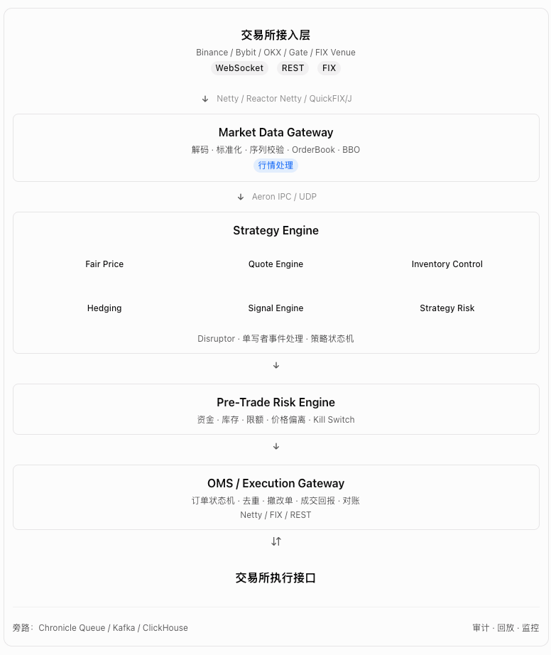
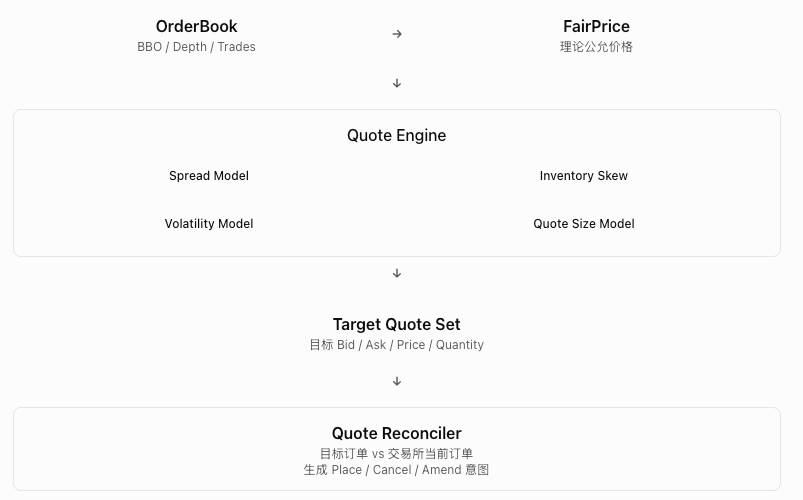

# 基于 Aeron + Netty + Disruptor 的高性能量化做市交易系统架构

我建议设计一套 Java 21 + Netty + Aeron + LMAX Disruptor + Chronicle Queue 的事件驱动量化做市系统。

目标不是简单实现“接收行情 → 计算报价 → 下单”，而是构建一个能够支持多交易所、多账户、多策略、低延迟行情处理、实时风控、订单生命周期管理和故障恢复的交易基础设施。

首先明确一个重要原则：

> Netty 负责网络通信，Aeron 负责跨进程高速消息传输，Disruptor 负责进程内事件流水线。三者不是竞争关系，也不应该为了使用技术而重复引入。

## 一、系统总体架构



上图是逻辑架构，不意味着每个方框都必须独立部署。第一版可以采用 4 个主要进程：行情网关、策略引擎、风控与 OMS、执行网关。是否进一步拆分，需要用延迟、吞吐量和故障隔离测试决定。

## 二、三大核心技术的职责

| 技术            | 负责什么                                 | 不应该负责什么             |
| --------------- | ---------------------------------------- | -------------------------- |
| Netty           | WebSocket、TCP、FIX 网络连接、解码、重连 | 策略计算、重型业务处理     |
| Aeron           | 进程间低延迟发布订阅、行情分发、指令传输 | 持久化交易账本             |
| Disruptor       | 进程内事件排序、线程解耦、单写者状态更新 | 跨机器消息可靠投递         |
| Chronicle Queue | 本地持久化日志、事件回放                 | 代替交易所订单状态核验     |
| Kafka           | 异步审计、数据分析、历史事件流           | 默认承担最低延迟下单主链路 |

这里有一个需要特别纠正的设计思路：Disruptor 不等于一定更快，Aeron 也不等于消息不会丢失。

真正决定性能和正确性的，是事件所有权、背压处理、序列一致性以及故障恢复机制。

## 三、做市策略核心设计

做市策略应拆成五个独立的计算模块，而不是把所有逻辑放在一个 `MarketMakingStrategy` 类里。



### 3.1 公允价格模型


Microprice 高于 MidPrice，意味着当前最优买盘数量相对更大，但这只是短期价格压力的一个特征，不代表价格必然上涨。

### 3.2 库存偏移模型

做市商不能只关注买卖价差，还必须控制单边库存。

可以用简化模型：


其中：

| 参数          | 含义             |
| ------------- | ---------------- |
| FairPrice | 理论公允价格     |
| \(\gamma\)    | 风险厌恶系数     |
| \(q\)         | 当前净库存       |
| \(\sigma\)    | 价格波动率       |
| \(T\)         | 风险调整时间尺度 |

当库存过多时，Reservation Price 下移，策略倾向于降低买入积极性、提高卖出积极性。

注意：这个公式来自特定模型假设。实际系统必须校准单位、波动率口径、交易费用和库存边界，不能直接拿参数上线。

### 3.3 报价计算

\[ Bid=ReservationPrice-\frac{Spread}{2} \]

\[ Ask=ReservationPrice+\frac{Spread}{2} \]

随后需要进行 tickSize 对齐、最小下单数量检查、maker/taker 费用检查、价格保护和交易所过滤器校验。

## 四、Disruptor 线程模型

我不建议把一个 Disruptor RingBuffer 交给所有交易对共享，然后让每个策略同时修改多个 Symbol 状态。

建议采用 Symbol Sharding + Single Writer。

```
Netty WS IO Threads
        │
        ▼
Market Event Dispatcher
        │
        ├── shard 0 → Disruptor 0 → BTC / ETH
        │
        ├── shard 1 → Disruptor 1 → SOL / XRP
        │
        ├── shard 2 → Disruptor 2 → ...
        │
        └── shard N → Disruptor N → ...
```

路由规则：

```
int shard = Math.floorMod(
        Objects.hash(exchange, symbol),
        shardCount
);
```

每个分片维护：

```
public final class MarketShardHandler
        implements EventHandler<MarketEvent> {

    private final Map<MarketKey, OrderBookEngine> books;
    private final Map<MarketKey, StrategyEngine> strategies;

    @Override
    public void onEvent(
            MarketEvent event,
            long sequence,
            boolean endOfBatch) {

        MarketKey key = event.marketKey();

        OrderBookEngine book = books.get(key);
        book.onEvent(event);

        if (book.isLive()) {
            strategies.get(key).onMarketUpdate(book);
        }
    }
}
```

这是架构示意代码，实际还需要补齐类型定义、事件回收和错误处理。

重要边界： 同一个交易对的行情处理可以单写者，但账户库存和风险额度可能被多个交易对共同使用，不能简单依赖 Symbol 分片保证账户级一致性。

账户状态应当有独立所有者，或通过预留额度协议实现并发控制。

## 五、Aeron 通道规划

Aeron 应用于跨进程通信，不必在每个 Java 方法调用之间插入 Aeron。

| Stream ID（示例） | 数据                     | 方向               |
| ----------------- | ------------------------ | ------------------ |
| 1001              | Normalized Market Data   | Gateway → Strategy |
| 1002              | Book Snapshot / Recovery | Gateway → Strategy |
| 2001              | Quote Intent             | Strategy → Risk    |
| 2002              | Approved Order Intent    | Risk → OMS         |
| 3001              | Execution Report         | Gateway → OMS      |
| 3002              | Position / Order State   | OMS → Strategy     |
| 9001              | Health / Control Events  | 双向               |

Stream ID 只是逻辑划分。真实部署还要设计 Session、Channel、发布者所有权和消息版本。

我会特别要求三个可靠性约束：

1. Aeron `offer()` 返回背压或未连接状态时，不能默默丢弃订单指令。
2. 市场行情可以采用受控的丢弃和重同步策略，但订单、成交与资金状态不能依赖“最新值覆盖旧值”。
3. 对于跨进程重启恢复，必须有持久化日志、快照或交易所对账机制。普通 Aeron Publication 本身不提供持久化保证。

## 六、OMS：比策略算法更重要的状态机

做市策略最终生成的是订单意图，而不是直接调用交易所下单接口。

建议 OMS 至少维护以下状态：

```
NEW_INTENT
    │
    ▼
RISK_APPROVED
    │
    ▼
PENDING_NEW
    │
    ├── ACK ──────────→ WORKING
    │                       │
    │                       ├── PARTIALLY_FILLED
    │                       ├── FILLED
    │                       └── PENDING_CANCEL
    │                                  │
    │                                  └── CANCELED
    │
    ├── REJECTED
    │
    └── UNKNOWN → RECONCILIATION
```

这里最容易被忽视的是 `UNKNOWN`。

例如向交易所发送下单请求后连接断开，你不知道订单是否已经被接受。

此时不能直接重新下单，否则可能产生重复挂单。应先通过 `clientOrderId`、订单查询和成交回报核对状态，再决定是否重试。

OMS 至少需要管理：

- `clientOrderId` 和 `exchangeOrderId` 的映射。
- 成交回报去重与乱序处理。
- 部分成交后的剩余数量。
- 撤单与成交同时发生的竞态。
- 重连后的 Open Orders 与历史成交对账。
- 策略暂停、账户限额和全局 Kill Switch。

## 七、项目工程结构

建议 Maven 多模块，而不是一个巨大的 Spring Boot 工程。

```
quant-trading/
│
├── quant-common/
│   ├── model/
│   ├── codec/
│   └── protocol/
│
├── quant-market-gateway/
│   ├── netty/
│   ├── adapter/
│   ├── orderbook/
│   └── publisher/
│
├── quant-aeron/
│   ├── transport/
│   ├── publication/
│   └── subscription/
│
├── quant-strategy/
│   ├── disruptor/
│   ├── fairprice/
│   ├── quoting/
│   ├── inventory/
│   └── hedging/
│
├── quant-risk/
│   ├── pretrade/
│   ├── limits/
│   └── killswitch/
│
├── quant-oms/
│   ├── order/
│   ├── execution/
│   └── reconciliation/
│
├── quant-exchange/
│   ├── binance/
│   ├── bybit/
│   └── fix/
│
├── quant-storage/
│   ├── chronicle/
│   └── kafka/
│
├── quant-backtest/
│   ├── replay/
│   ├── simulator/
│   └── metrics/
│
└── quant-bootstrap/
```

建议把 Spring Boot 放在管理面（配置、监控、控制台），核心行情和策略热路径尽量避免不必要的框架抽象和对象分配。

## 八、关键性能指标

下面是我建议用于第一阶段测试的工程目标，而不是已验证的系统性能。

| 指标                 | 第一阶段目标                   |
| -------------------- | ------------------------------ |
| 单分片行情处理       | 10万 events/s 压测起点         |
| 进程内事件处理 p99   | 100 μs 内，待验证              |
| Aeron IPC p99        | 50 μs 内，待验证               |
| OrderBook 序列一致性 | 所有缺口必须检测或标记不可验证 |
| OMS 订单状态         | 不允许静默丢失状态变更         |
| 风控限额             | 所有订单必须经过统一检查       |
| 故障恢复             | 具备可重复的恢复测试           |
| 交易环境             | 先模拟盘，再测试网             |

这些指标必须区分吞吐量、排队延迟、处理延迟和端到端延迟，并注明硬件、消息大小、负载以及 GC 条件。不能把单机空载 IPC benchmark 当作真实交易链路的性能。

## 九、从零落地的开发路线

